# 计及跨事件算储联合恢复的数据中心综合能源系统连续需求响应优化调度 —— 论文主要思路与可复现实验设计（修订版）

> 本文档给出论文的完整故事线、模型、理论结果、方法、算例设计与仿真结果（审稿修订 + 对标 Applied Energy 的升级）。所有数值均由仓库中 `matlab/main_run_all.m` 在公开数据上复现（GNU Octave 8.4 + glpk 实测；MATLAB `intlinprog`/Gurobi 同样可运行），并由 `python3 tools/summarize_results.py` 输出。参数逐项标注来源：**[S]** 取自文献/政策原文，**[D]** 由公开数据推导，**[A]** 学术假设（均在敏感性分析中检验）。证明见 [`理论推导.md`](理论推导.md)；英文图件在 `matlab/figures_en/`。图号与 `matlab/figures/` 中的文件编号一致；图 3、4（时序）与图 13（稳健性）是补充图，未放入正文，投稿时按出现顺序重新编号。

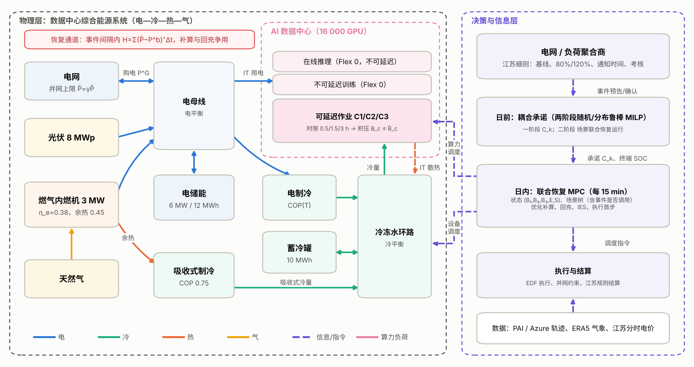

*图 0a 系统物理—信息协同架构。*

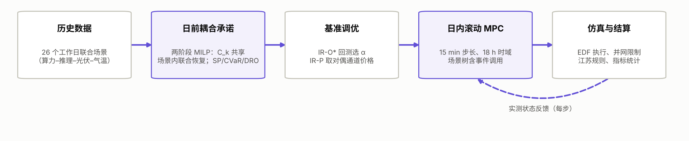

*图 0b 日前耦合承诺—日内滚动联合恢复框架（算法 1）。*

---

## 摘要

**中文摘要：** 人工智能数据中心参与连续需求响应时，前序事件留下的任务积压与储能缺口都要在事件间隔内恢复，二者争用受并网容量限制的同一恢复通道。针对这一跨事件耦合问题，提出计及算储联合恢复的数据中心综合能源系统连续需求响应优化调度方法。首先，以滞后上界刻画分级服务等级协议，证明其与“最早截止期优先下每个任务都不超期”等价，把可延迟算力表述为容量由完成时限决定的虚拟储能，结合并网容量与电—冷—热平衡构建算储多状态恢复模型；给出后续事件可交付能力的解析上界、简化模型下联合恢复价值的闭式解与单一恢复通道价格原则。其次，建立日前耦合承诺—日内滚动联合恢复框架，嵌入江苏需求响应结算规则，并把分布鲁棒日前承诺精确化为混合整数线性规划。基于阿里 PAI GPU 集群轨迹、上海人工智能实验室 Acme 大模型开发轨迹、Azure 大模型推理轨迹与 ERA5 气象的 16 000 卡算例表明：事件间隔不超过 1 h 时，独立恢复只剩单事件能力的约 38%，联合恢复在相同事后状态下 0.75 h 内即可恢复到 96%；与日前调优分摊、通道价格协调等最强独立基准相比，52 个运行日中联合恢复每天三次事件全部有效（基准为 86%~98%），综合成本降低 2.9%~4.0%（p<10⁻⁹）；可靠可交付容量由 6 MW/次提高到 8 MW/次，相当于约 9~12 MWh 电储能或 2.9 MW 并网容量；把承诺推广为可交付承诺向量的集合后，联合恢复的能力域可由单事件能力与一个跨事件能量预算精确描述，独立恢复即使分摊比例事后最优也使该预算收缩约 18%，只交换通道价格时能否交付取决于等价最优响应的选择；分布鲁棒承诺在样本外同时降低平均与尾部成本。作业级仿真表明，流体任务模型对整组运行的刚性长作业过于乐观；加入刚性补算约束后计划可以执行，联合恢复在 PAI 与 Acme 负荷下的作业级成本仍比最强独立基准低 3.0%~5.0%。表后海上风电（绿电直连）下，按关口表计量的基线使可交付承诺随装机下降，而联合恢复的成本优势扩大到 5.9%~6.6%。冬季余热回收供热比燃气锅炉每天省约 16% 的成本，蓄热罐使热泵成为可在事件中关停、事后补热的灵活资源。上述结论在不同分时电价形态、季节与气候、液冷、机房热惯性、暂停/恢复开销与日前场景生成方式下保持稳健。

**关键词：** 人工智能数据中心；连续需求响应；算储联合恢复；虚拟储能；分布鲁棒优化；综合能源系统

**English abstract:** When an AI data center answers consecutive demand-response (DR) events, each event leaves deferred computing work and depleted storage, and both must be recovered in the short gaps between events through the same grid-connection headroom. This paper formulates cross-event joint computing–storage recovery for AI data-center integrated energy systems. A lag-bounded backlog constraint models tiered service-level agreements; we prove that it is equivalent to deadline-feasible earliest-deadline-first execution, which turns deferrable computing into a virtual storage whose capacity is set by deadlines. Combined with the connection limit and the electricity–cooling–heat balances, the model captures how catch-up computing, storage recharging and the next event's capability interact. We derive an upper bound on the next event's deliverable capability, a closed-form value of joint recovery in a stylised model, a single recovery-channel price, and an exact mixed-integer linear reformulation of the distributionally robust day-ahead commitment. A day-ahead coupled-commitment and intraday rolling joint-recovery framework embeds the Jiangsu DR settlement rules. In a 16 000-GPU case built from public Alibaba PAI, Shanghai AI Laboratory Acme (LLM development) and Azure traces and ERA5 weather, independent recovery leaves about 38 % of the next event's stand-alone capability for gaps of one hour or less, whereas joint recovery restores 96 % within 0.75 h. Against the strongest tuned and price-coordinated independent benchmarks, joint recovery keeps every event valid on all 52 operating days (benchmarks: 86–98 % of days) and lowers the total cost by 2.9–4.0 % (p < 10⁻⁹). It raises the reliably deliverable capacity from 6 to 8 MW per event, which is worth about 9–12 MWh of battery or 2.9 MW of connection capacity. Generalising the commitment to the set of deliverable commitment vectors, the joint-recovery capability region is described exactly by the stand-alone capabilities and one cross-event energy budget; independent recovery shrinks that budget by about 18 % even with a hindsight-optimal split, and a price signal alone delivers it only if the IT side picks the right one of its many optimal responses. Distributionally robust commitments lower both the mean and the tail cost out of sample. A job-level simulation shows that the fluid workload model is too optimistic for rigid gang-scheduled long jobs; with a rigid-job recovery bound the plans become executable, and joint recovery remains 3.0–5.0 % cheaper than the strongest independent benchmark at job level on both the PAI and the Acme workloads. With behind-the-meter offshore wind (green-power direct connection), the meter-based baseline shrinks the deliverable commitments as the wind capacity grows, while the cost advantage of joint recovery widens to 5.9–6.6 %. Recovering waste heat for winter heating with a heat pump costs about 16 % less than a gas boiler, and a hot-water tank turns the heat pump into a flexible load that is switched off during events and recharged afterwards. The results hold across tariff shapes, seasons and climates, liquid cooling, server-room thermal inertia, pause/resume overheads and day-ahead scenario generation.

**Keywords:** AI data center; consecutive demand response; joint computing–storage recovery; virtual storage; distributionally robust optimisation; integrated energy system

---

## 1 题目、关键词与研究定位

**题目：** 计及跨事件算储联合恢复的数据中心综合能源系统连续需求响应优化调度
（Coordinated Scheduling for Consecutive Demand Response in AI Data Center Integrated Energy Systems Considering Cross-Event Computing–Storage Recovery）

**关键词：** 人工智能数据中心；连续需求响应；任务积压；算储联合恢复；跨事件状态耦合；可交付能力；优化调度

### 1.1 背景（均为可核查的事实）

* **负荷规模。** IEA《Energy and AI》(2025)：2024 年全球数据中心用电约 415 TWh（约占 1.5%），2030 年将增至约 945 TWh[1]。LBNL（2024.12）：美国数据中心 2023 年用电 176 TWh、占 4.4%，2028 年情景为 325–580 TWh[2]。我国《数据中心绿色低碳发展专项行动计划》(2024)要求新建大型及超大型数据中心 PUE ≤1.25[3]。
* **并网约束成为瓶颈，柔性被视为接网条件。** Duke 大学（Norris 等, 2025）测算：大负荷每年可削减 0.25%–1% 的时间，美国 22 个平衡区即可多接入 76–126 GW[4]；Chen 与 Zheng（2026）的扩容规划模型表明 AI 负荷柔性可降低 3%–21% 的电网投资与运行成本，但收益随延迟窗口加长而递减[5]；Williams 等（2026）系统讨论了“功率柔性 AI 数据中心”作为电网响应资源的范式[6]。美国得克萨斯州 2025 年的 SB 6 法案把大负荷接网与电网紧急时的削减义务挂钩[7]。
* **需求响应政策与实践。** 《电力需求侧管理办法（2023 年版）》要求需求响应能力达到最大用电负荷的 3%–5%[8]。《江苏省电力需求响应实施细则》(2024)：约定响应每日不多于 2 次、累计不超过 2 h；有效响应判定为平均负荷较基线下降 ≥80% 确认值且最大负荷不高于基线最大负荷，超过 120% 按 120% 计；削峰补贴最高 3 元/kWh，提前 2–4 h、0.5–2 h 通知的速度系数为 1.4、1.6；基线取前 5 个正常工作日平均负荷[9]。Emerald AI 在凤凰城 256 卡集群上实现 3 h 降功率 25%[10]。
* **AI 负载的新调节手段与可靠性问题。** Acun 等（ACM e-Energy 2026）基于仿真给出 AI 数据中心 18%–55% 的功率柔性[11]；Du 等（2026）把推理量化作为附加的需求响应手段[12]；Li（2026）基于 15.5 万 GPU、185 天的生产轨迹指出，“标量柔性比例”会把可兑现的负荷削减高估 17%–47%，主张合同中采用持续时间、可靠性等指标[13]；Choukse 等（2025）报道了大规模训练的功率摆动问题[14]。
* **储能“恢复保证”。** Evans、Tindemans 与 Angeli（IEEE TSG 2022）为聚合储能提出带恢复保证的柔性框架，把放电与恢复耦合，并用单一虚拟电池刻画恢复能力[15]——这是与本文最接近的工作。

### 1.2 研究空白

| 已有研究 | 主要做法 | 与本文差异 |
|---|---|---|
| 数据中心 DR 经典工作[16-18]、碳感知计算[19] | 负荷时空迁移 + 本地发电，单次或日内峰值管理 | 未刻画事件之间的状态耦合 |
| 数据中心多层/多时间尺度 DR 调度[20]、IES 规划运行[21,22] | 冷热电多能互补、负载时空可调 | 储能与算力的“恢复”被视为各自子问题 |
| 储能恢复保证[15]、柔性负荷虚拟电池[23] | 同质、有损的物理储能，放电与恢复耦合，虚拟电池 | 本文是**异质双状态**：时限约束、近乎无损的“虚拟储能”（积压）与有损物理储能，跨事件争用同一恢复通道；两类状态的最优恢复不是“各自补满” |
| AI 负载柔性与新调节手段[6,11,12,24]、可兑现削减[13] | 单次事件的可削减量、调节手段与合同口径 | 未考虑前序响应留下的恢复需求如何吞噬后续事件的可交付能力 |
| 现场示范[10,25] | 单事件 3 h 削减 | 事件后补算与储能回充未优化 |

**本文要回答的新问题：** 当多次 DR 事件间隔很短时，任务补算与储能回充共享有限的恢复通道，前序响应的“双状态欠账”如何决定后续响应能力？联合恢复相对**调优过的**独立恢复、价格协调与逐事件联合能带来多大改善？改善何时消失？

### 1.3 主要贡献

1. **算储多状态恢复模型。**
   - 用“滞后上界”刻画 Flex 分级 SLA，把可延迟算力表述为容量由时限决定、往返效率≈1 的虚拟储能，与电/冷储能构成恢复状态。
   - 引理 1 证明该时限约束与 EDF 下“每个任务都不超期”等价，既充分又必要。常数队列上限不能保证时限，或过于保守。
   - 可选地把机房热惯性作为第三类恢复状态，把冬季余热回收的蓄热罐作为第四类恢复状态。
   - 结合并网容量与电–冷–热平衡，刻画补算、回充与后续能力的耦合。
   - 可选的刚性补算约束：作业级仿真表明，流体积压模型对整组运行的长训练作业过于乐观；加入该约束后计划可在作业级执行（6.13 节）。
2. **理论结果（附完整证明，见 [`理论推导.md`](理论推导.md)）。**
   - **命题 1**：后续事件可交付能力的解析上界，可推广到多状态。
   - **定理 1**：简化模型下联合恢复价值与最小恢复间隔的闭式解，$\tau^*_{\rm IR}-\tau^*_{\rm JR}=\min(X,p_f(L-D_B))/h$，并给出“联合恢复何时无价值”的充要条件。
   - **命题 2**：单一恢复通道价格与等边际价值原则，并解释静态价格协调为何不足。
   - **命题 3**：ℓ1 球分布鲁棒日前承诺的精确 MILP 重构（含随机规划、场景鲁棒两个极限与 CVaR 推论）。二阶段含江苏有效性 0–1 变量时仍精确，无需 SDP 与 C&CG。
   - **命题 4**：把单个承诺值推广为可交付承诺向量的集合（能力域），给出不依赖“基线无偏”假设的多事件能量界（带回充的虚拟电池）与可验证的内近似；独立恢复的损失即该集合的收缩。
3. **日前耦合承诺—日内滚动优化框架（算法 1）。**
   - 日前：两阶段随机/分布鲁棒 MILP，以耦合恢复约束确定各事件承诺。
   - 日内：确定性/场景 MPC 联合优化任务执行、储能与 IES，并处理事件是否被调用的不确定性（场景树）。
   - 给出模型规模与求解时间随时域、场景数、事件数的变化。
4. **面向最强基准的评估与工程洞见。**
   - **基准：** 日前回测调优分摊比例的独立恢复、日前影子价格协调的独立恢复、逐事件联合恢复。
   - **评估内容：**
     - 反弹考核作为政策参数的权衡曲线；
     - “可靠可交付容量”及其物理等价，即联合恢复相当于多少电储能与并网容量（虚实替代）；
     - 机理贡献瀑布与收益来源拆解；
     - 52 个运行日蒙特卡洛（置信区间与配对检验）；
     - 分布鲁棒承诺的样本外帕累托前沿；
     - 电价形态、季节与气候、PUE 与绿电约束、液冷、IT 爬坡、GPU 功率封顶等稳健性检验。
     - 作业级验证：Acme 大模型开发轨迹、整组刚性作业、检查点/重启开销；
     - 扩展：绿电直连风电、暂停/恢复开销与多档封顶、K-means 场景与季节漂移、冬季余热回收供热。
     - 可交付能力域：哪些承诺向量能足额交付，独立恢复与价格协调使它收缩多少，以及按虚拟电池参数申报的报价含义。
   - **边界条件：** 同时给出联合恢复优势消失的条件。

---

## 符号表（Nomenclature）

**集合与下标**

| 符号 | 含义 |
|---|---|
| $t\in\mathcal T=\{1,\dots,120\}$，$\Delta t$ | 时间步（00:00 至次日 06:00），步长 0.25 h |
| $c\in\{1,2,3\}$ | 可延迟任务类别（短/中/长作业） |
| $k\in\mathcal K$，$\mathcal T_k=[s_k,e_k]$，$D_k$ | 需求响应事件、事件时段、持续时间 |
| $\mathcal W_k$ | 事件 $k$ 的反弹考核窗口（事件后 2 h） |
| $\omega\in\Omega$，$\hat p_\omega$ | 场景及其经验概率 |

**参数**

| 符号 | 含义 | 取值/来源 |
|---|---|---|
| $N$，$p^{\rm idle}$，$p^{\rm dyn}$ | GPU 数、单卡空闲功率、单卡动态功率 | 16 000；0.26、0.79 kW |
| $\kappa$ | 推理 GPU 的动态功率系数 | 0.65 |
| $G^{\rm inf}_t$，$G^{\rm fix}_t$ | 推理、不可延迟训练占用的 GPU 数 | Azure、PAI 轨迹 |
| $a_{c,t}$ | 第 $c$ 类可延迟任务名义到达量（GPU·h） | PAI 轨迹 |
| $L_c$ | 滞后上界（时限） | 0.5/1.5/3 h |
| $\bar B_{c,t}=\sum_{\tau\in(t-L_c,t]}a_{c,\tau}$ | 由时限决定的积压上界（虚拟储能容量，引理 1） | — |
| $a$，$\theta$ | 配电/空调辅机损耗系数；单位 IT 功率的散热量 | 0.05；1.0 MW$_{\rm th}$/MW |
| ${\rm COP}_t$ | 电制冷 COP（随气温变化） | ERA5 气温 |
| $\varepsilon_t=(1+a+\theta/{\rm COP}_t)p^{\rm dyn}$ | 每 GPU·h 任务对应的设施用电 | — |
| $\bar P=\gamma\hat P$，$P^{\min}$ | 并网容量上限、最小购电 | γ=1.10 → 16.03 MW；1.5 MW |
| $P^{\rm b}_t$ | 需求响应基线（前 5 个工作日平均） | — |
| $\pi_t$，$\pi_k$ | 分时电价；事件补贴单价 | 江苏 2025；3/4.2/4.8 元/kWh |
| $\kappa^{\rm dev}$，$c^{\rm rb}$，$c^{\rm pre}$ | 短缺考核系数；反弹考核单价；事件前抬升考核单价 | 江苏细则；0–6 元/kW；0 |
| $c^{\rm jct}$，$c^{\rm late}$ | 任务延迟成本；逾期罚价（等效硬 SLA） | 0.5、1000 元/(GPU·h·h) |
| $\bar P^{\rm BESS}$，$E^{\min/\max}$，$\eta_c,\eta_d$，$c^{\rm deg}$ | 电储能功率、电量上下限、充放电效率、退化成本 | 6 MW；1.2/11.4 MWh；0.95；60 元/MWh |
| $\bar Q^{\rm TES}$，$S^{\min/\max}$，$\eta^{\rm TC},\eta^{\rm TD}$ | 蓄冷功率、容量上下限、效率 | 4 MW$_{\rm th}$；1/10 MWh$_{\rm th}$；0.98 |
| $\bar P^{\rm GT}$，$\eta_e$，$\eta_h$，${\rm COP}^{\rm AC}$ | 内燃机容量、发电效率、余热回收效率、吸收式制冷 COP | 3 MW、0.38、0.45、0.75 |
| $\delta$ | 日前分布鲁棒承诺的模糊集半径（$\ell_1$ 球，第 4.1 节） | 0–2 |
| $\tau_c$ | 刚性作业补算时间常数：按卡数加权的平均作业时长（可选，3.1 节） | PAI 0.26/3.6/26.3 h；Acme 0.11/4.2/39.5 h |
| $o_c$ | 每张新暂停 GPU 的暂停/恢复开销（检查点 + 重启，可选） | 0（基准）；0.1、0.42 h（实验 22） |
| $(\rho_l,\ell_l)$ | GPU 功率封顶档位：动态功率降幅与吞吐损失（可选） | 单档 (0.30, 0.12)；三档 (0.15/0.30/0.45, 0.03/0.12/0.30) |
| $\bar P^{\rm W}_t$ | 绿电直连风电的可用出力（可选，表后接入） | 0–40 MW 装机，如东海上 ERA5 风速 |
| $\bar P^{\rm HP}$，${\rm COP}^{\rm HP}$，$\bar H$，$q^{\rm dh}_t$ | 余热回收热泵电功率上限与制热 COP、蓄热罐容量、供热管网热需求（可选，冬季） | 3 MW、3.5；0/20/40 MWh$_{\rm th}$；$0.3\max(18-T_t,0)$ MW$_{\rm th}$ |

**决策与状态变量**

| 符号 | 含义 |
|---|---|
| $y_{c,t}$ | 第 $c$ 类可延迟任务执行的 GPU 数 |
| $\zeta_{c,t}$，$w_{c,t}$ | 事件中封顶降低的动态功率（GPU 当量）及其吞吐损失（可选） |
| $u_{c,t}$ | 相对名义负荷新暂停的 GPU 数（暂停开销，可选） |
| $B_{c,t}$，$v_{c,t}$ | 积压（算侧恢复状态，GPU·h）；逾期量 |
| $P^{\rm G}_t$ | 购电功率 |
| $P^{\rm ch}_t,P^{\rm dis}_t$，$E_t$ | 电储能充放电功率、电量（储侧恢复状态） |
| $Q^{\rm TC}_t,Q^{\rm TD}_t$，$S_t$ | 蓄冷充放功率、蓄冷量 |
| $P^{\rm HP}_t$，$Q^{\rm B}_t$，$H_t$ | 热泵电功率、燃气锅炉补热、蓄热量（第四类恢复状态，可选） |
| $P^{\rm GT}_t$，$H^{\rm AC}_t$，$Q^{\rm EC}_t$，$P^{\rm PV}_t$ | 内燃机出力、送吸收式制冷的余热、电制冷冷量、光伏出力 |
| $C_k$ | 事件承诺容量（日前一阶段决策） |
| $\bar r_k$，$z_k$，$R_k$，$s_k$ | 平均削减、有效性 0–1 变量、可结算削减、短缺量 |
| $\rho_k$ | 反弹窗口内超过基线的最大功率 |
| $\lambda_t$，$\nu_t$，$\mu_{c,t}$ | 恢复通道价格、储能状态边际价值、积压边际成本（命题 2） |

---

## 2 系统与问题描述

**AIDC-IES 结构：** 16 000 张 H100 级 GPU（2 000 台 8 卡 HGX 节点）；电–冷–热耦合：电网（容量 $\bar P$）、光伏 8 MWp、3 MW 燃气内燃机 + 余热吸收式制冷机、电制冷机组（COP 随气温变化）、10 MWh 冷水蓄冷罐、6 MW/12 MWh 电储能。

**负载分层（对应 Emerald AI Flex 分级）：**

| 类别 | 来源 | 可延迟性 | 滞后上界 $L_c$ |
|---|---|---|---|
| 在线推理（Flex 0） | Azure LLM 2024 轨迹形状 | 不可延迟 | 0 |
| 不可延迟训练（Flex 0） | PAI 轨迹 × 25% | 不可延迟 | 0 |
| C1 短作业（运行时长 ≤1 h） | PAI 轨迹 × 75% | Flex 1 | 0.5 h |
| C2 中作业（1–12 h） | 同上 | Flex 2 | 1.5 h |
| C3 长训练（>12 h） | 同上 | Flex 3 | 3 h |

**连续 DR 时序（江苏规则）：** E1 17:00–18:00、E2 19:00–20:00 为日前约定响应（3 元/kWh）；E3 21:00–22:00 为快速避峰响应（日前预通知、提前 3 h 确认，速度系数 1.4，4.2 元/kWh）。**不确定性变体：** E3 日前只作为“可能事件”预告，以概率 0.6 被调用，提前 1 h（20:00）确认或取消（速度系数 1.6，4.8 元/kWh）。

**恢复状态与“恢复通道”：** 事件结束时刻的状态 $\mathbf{x}_{e_k}=(B_1,B_2,B_3,E,S)$。本文所说的“双状态”指算侧与储侧两类恢复状态，实际是这个 5 维状态向量（3 类积压 + 电储能 + 蓄冷）；计入机房热惯性、余热蓄热罐时分别再加 1 维。事件间隔内可用于恢复的能量为 $H_k=\sum_t(\bar P-P^{\rm b}_t)^+\Delta t$（反弹窗口受考核时还要扣去被考核的部分）。补算与回充争用 $H_k$，并受 GPU 空闲容量、储能功率与截止时间约束。

---

## 3 算储双状态恢复模型

时间步 $\Delta t=0.25$ h，仿真窗口 00:00 至次日 06:00（120 步）。3.1–3.2 与初稿相同，此处只列关键式，3.3–3.5 为修订内容。

### 3.1 算侧：负载功率与积压状态

$$P^{\rm IT}_t=Np^{\rm idle}+P^{\rm oth}+p^{\rm dyn}\Big(\kappa G^{\rm inf}_t+G^{\rm fix}_t+\sum_c y_{c,t}\Big),\qquad B_{c,t}=B_{c,t-1}+a_{c,t}-y_{c,t}\Delta t,\qquad B_{c,t}-v_{c,t}\le\bar B_{c,t}:=\sum_{\tau\in(t-L_c,t]}a_{c,\tau}$$

IT 功率取“空闲 + 动态”线性模型[26]；$\varepsilon_t=(1+a+\theta/{\rm COP}_t)p^{\rm dyn}$ 为每 GPU·h 的设施用电，$X_t=\varepsilon_t\sum_cB_{c,t}$ 是虚拟储能的放空量。

**可选：GPU 功率封顶（多档，审稿意见 6、P2-M6）。** 事件中第 $c$ 类可把动态功率降低 $\zeta_{c,t}$（GPU 当量），$\zeta_{c,t}\le\rho_{\max}y_{c,t}$。单卡“功率降幅—吞吐损失”曲线取过原点、经过档位 $(\rho_l,\ell_l)$ 的凸分段线性函数（降频降压时功率约按频率的高次方下降，吞吐按频率线性下降，降幅越深边际损失越大）。同类 GPU 可处于不同档位，故整类的吞吐损失为该曲线的透视函数，可精确写成线性约束
$$w_{c,t}\ge s_l\zeta_{c,t}+i_ly_{c,t}\ \ (l=1,\dots,n),\qquad w_{c,t}\ge0,$$
其中 $s_l,i_l$ 为各段斜率与截距。积压方程中执行量变为 $(y_{c,t}-w_{c,t})\Delta t$，IT 功率减去 $p^{\rm dyn}\zeta_{c,t}$。单档时 $w=\beta\zeta$（$\rho=0.3$，$\beta=0.4$），即每单位降功率留下 0.4 的恢复欠账（暂停为 1），与初稿相同。封顶只允许在事件时段使用，以免把“封顶更省能”混入常态运行。

**可选：刚性作业的补算速率（审稿意见 6f）。** 训练作业是整组运行的刚性作业，被暂停的作业不能用更多的卡加速，延迟只在其名义结束之后才补回。据此（推导见 [`理论推导.md`](理论推导.md) 第 1 节末）可加入
$$y_{c,t}\le a_{c,t}/\Delta t+B_{c,t-1}/\tau_c ,$$
$\tau_c$ 取轨迹中按卡数加权的平均作业时长。不加此约束即为“流体”模型（基准），意味着积压可在空闲 GPU 上以任意并行度补算；两者分别对应可塑的批处理/评测负载与刚性的预训练负载，并都由作业级仿真检验（5.4 节、实验 19–20）。

**可选：暂停/恢复开销（P2-M6）。** 相对名义负荷新暂停的 GPU 数 $u_{c,t}\ge(a_{c,t}/\Delta t-y_{c,t})-(a_{c,t-1}/\Delta t-y_{c,t-1})$，$u\ge0$；每张新暂停的卡增加 $o_c$ GPU·h 的工作量（暂停前写检查点、恢复后重新加载与初始化），即积压方程右端加 $o_cu_{c,t}$。$o_c=(1+5)/60$ h 对应异步检查点 1 min + 重启 5 min，$(10+15)/60$ h 对应大模型同步检查点与慢重启。最短暂停时长需要 0–1 变量，流体模型不计，由作业级仿真检验。

**可选：IT 功率爬坡限制**（软约束，$|\Delta\sum_cy_c|p^{\rm dyn}\le R$ MW/15 min，超出部分 $5\times10^4$ 元/MW 罚价）。

### 3.2 储侧与综合能源系统

电储能、蓄冷罐、冷平衡、电平衡、并网约束 $P^{\min}\le P^{\rm G}_t\le\bar P=\gamma\hat P$ 同初稿（式 (4)–(8)）。

**可选：机房热惯性（第三类恢复状态，实验 17）。** 把数据机房与冷冻水环路的热容看作一个“热储能”，记 $\Theta_t$ 为高于送风设定值的蓄热量（MWh$_{\rm th}$）：
$$\Theta_t=\Theta_{t-1}+\Delta t\,(Q^{\rm load}_t-Q^{\rm sup}_t),\qquad -C^{\rm th}\Delta T^{\rm dn}\le\Theta_t\le C^{\rm th}\Delta T^{\rm up}.$$
冷平衡改为“供冷 + 蓄热变化 = 冷负荷”。事件中可以少供冷、让机房在允许范围内升温（相当于放电）；事后必须把热量移走。这与补算、储能回充争用同一个恢复通道。期末仍高于设定值的蓄热按移除所需电费计价。$C^{\rm th}=2$ MWh$_{\rm th}$/K，$\Delta T^{\rm up}=3$ K，$\Delta T^{\rm dn}=2$ K。

**可选：绿电直连风电（P2-M5，实验 21）。** 按《关于有序推动绿电直连发展有关事项的通知》（发改能源〔2025〕650 号）[27]，新能源可不接入公共电网、通过专线向单一用户供电；项目自发自用电量应不低于总可用发电量的 60%，占用户总用电量不低于 30%（2030 年前不低于 35%），上网电量一般不超过 20%。本文以如东海上风电场址（32.6°N，121.6°E）的 ERA5 100 m 风速与 IEA 15 MW 参考风机[28]功率曲线（切入 3 m/s、额定 10.59 m/s、切出 25 m/s）、场站效率 0.9 生成可用出力 $\bar P^{\rm W}_t$，与光伏一起作为表后可弃的可再生电源（不上网），电平衡中 $P^{\rm PV}_t$ 换成光伏与风电之和。基线参考日与运行日用当日实际风速；风电无法像光伏那样由前几天推断，日前预测取实际出力叠加 AR(1) 误差（均方根为装机的 15%，15 min 自相关 0.97，约为数值天气预报水平），日前场景取围绕预测的误差路径，每个蒙特卡洛日各有自己的预测与场景；日内 MPC 仍按实测比值修正预测。并网容量保持无风电时的值。江苏基线取参考日的关口表数据，会继承参考日的风电，因此每个运行日都按当日风电预测重新求解日前承诺；确认承诺为 0 的事件视为未申报，不付费也不考核。风大的运行日，基线高于实际负荷；风小的运行日则相反，实际负荷可能高于基线，此时规划模型中“放弃事件”的约束需放松（大 M），否则无可行解。

**可选：余热回收供热（冬季，第四类恢复状态，实验 24）。** 数据中心余热温度低（冷冻水回水约 30 °C），需用热泵提升到 65–70 °C 才能送入供热管网。丹麦欧登塞的 Meta 数据中心就用大型热泵把余热送入城市热网[29]。《数据中心绿色低碳发展专项行动计划》要求加强余热回收，到 2030 年底北方采暖地区新建大型数据中心的余热利用率明显提高[3]；相关综述见 [30][31]。本文在冷冻水回路上接一台水源热泵（电功率 $P^{\rm HP}_t\le\bar P^{\rm HP}$，制热 ${\rm COP}^{\rm HP}$），经蓄热罐向附近管网供热，需求按度时法取 $q^{\rm dh}_t=k\max(T_b-T_t,0)$；热泵与蓄热罐供不上的部分由燃气锅炉补足（效率 $\eta_b$）：
$$H_t\le(1-\ell\Delta t)H_{t-1}+\Delta t\,({\rm COP}^{\rm HP}P^{\rm HP}_t+Q^{\rm B}_t-q^{\rm dh}_t),\qquad 0\le H_t\le\bar H.$$
不等号表示多余的热可以经冷却塔排掉。热泵从回路取走 $({\rm COP}^{\rm HP}-1)P^{\rm HP}_t$ 的热，冷平衡中相应减少电制冷的冷量；电平衡中多一项 $P^{\rm HP}_t$；锅炉燃气计入运行成本与碳排放。事件中可以关停热泵、由蓄热罐供热（相当于放电），事后蓄热罐要补热，与补算、储能回充争用同一并网余量，因此 $H_t$ 是第四类恢复状态。终端约束与电储能相同：时域末的蓄热量不低于无响应运行的参考值，差额按锅炉热价计入成本。正常运行（基线日）按分时规则：谷时把罐充满，峰时均匀放热，平时跟随热需求。

**可选：政策约束（实验 17）。** 均按评价窗口累计，滚动优化时计入已发生量，作为软约束：
- 电 PUE 上限：$\sum_t[(1+a)P^{\rm IT}_t+P^{\rm aux}+Q^{\rm EC}_t/{\rm COP}_t]\le{\rm PUE}^{\max}\sum_tP^{\rm IT}_t$；
- 绿电占比：$\sum_t(P^{\rm PV}_t+G_t)\ge g\sum_t(P^{\rm G}_t+P^{\rm PV}_t+P^{\rm GT}_t)$。其中 $G_t\le P^{\rm G}_t$ 为购入绿电，按环境溢价 $c^{\rm green}$ 计费。
- 联络线爬坡：$|P^{\rm G}_t-P^{\rm G}_{t-1}|\le R^{\rm G}$（软约束，超出部分按 $5\times10^4$ 元/MW 计罚），与 IT 功率爬坡限制同构。

### 3.3 江苏规则下的结算；反弹考核作为政策参数

事件 $k$ 的平均削减、有效性 0–1 变量、补贴（≤120%）、“最大负荷不高于基线最大负荷”、短缺考核 $\kappa\pi_kD_ks_k$ 同初稿。基线取前 5 个工作日的平均负荷，其取法会影响可结算的削减量[32]。修订要点：

1. **反弹考核 $c^{\rm rb}$ 改为政策参数。** 江苏细则中**没有**反弹考核，但事件后负荷回升（payback）是需求响应实施中的常见问题，例如 Wrinch 等的试点中每次事件后都出现 30%–50% 的反弹峰[33]。本文给出两套口径：**规则口径** $c^{\rm rb}=0$（只按江苏细则结算）与**反弹定价口径** $c^{\rm rb}=3$ 元/kW·次（事件后 2 h 内超过基线的最大功率），并在 0–6 元/kW 之间扫描（实验 8）。依据：连续事件说明电网在整个晚高峰持续紧张，间隔内的负荷反弹会直接抵消电网想要的削减；是否、以何价格考核由电网/聚合商决定。
2. **两部制需量电费能否替代反弹考核？** 按国家发展改革委规定，选择按最大需量计费的用户，实际最大需量超过合同值 105% 的部分基本电费加倍收取[34]；1–10 kV 需量电价各省多在 30–50 元/kW·月（本文取 40 元/kW·月作为假设）。但本算例中当月最大需量（15.29 MW）出现在**夜间谷段的储能/蓄冷充电时段**；DR 日本身是高温日，不响应时的峰值已达 15.83 MW。因此事件后反弹即使顶到并网上限 16.03 MW，也最多抬高需量约 0.2 MW（约 0.8 万元/月），**需量电费几乎不约束晚间反弹**——这正是需要单独设计反弹考核的原因。
3. **事件前抬升考核（可选）**：$c^{\rm pre}\sum_{t\in[s_1-3{\rm h},s_1)}(P^{\rm G}_t-P^{\rm b}_t)^+\Delta t$，默认 0（江苏细则无此项），实验 10 中取 1000 元/MWh 做敏感性。

### 3.4 目标函数与评价口径

目标函数同初稿式 (10)，修订三处：

1. 期末（次日 06:00）仍未执行的积压按平段电价能耗 $\varepsilon^{\rm ref}\lambda^{\rm flat}$（约 0.67 元/GPU·h）计价，消除“把补算推到评价窗口之外”的漏洞；
2. 终端储能/蓄冷缺口的价值取略高于夜间回充成本（500/100 元/MWh；回充成本分别为 (谷电价+退化)/η≈482 与 谷电价/(η·COP)≈77 元/MWh）；
3. 规划中有效性判定留 0.1 MW 安全裕度（$\bar r_k\ge0.8C_k+0.1$）。否则最优解恰好落在 80% 门槛上，计量或预测的微小偏差就会使整次事件无效。

**评价口径**（全部策略相同）：

| 指标 | 定义 |
|---|---|
| 兑现率 | $\sum_kD_k\min(\bar r_k,C_k)/\sum_kD_kC_k$（只对被调用的事件） |
| 真实削减 | 相对**同日不响应运行**（而非 5 日基线）的平均削减 |
| 事件前抬升 | 首个事件前 3 h 的购电相对基线、相对同日不响应运行的平均抬高 |
| 反弹 | 窗口内最大反弹（结算口径）；事件后 6 h 内最大反弹（与窗口无关）；事件间隔内高于不响应运行的回补电量 |
| 综合成本 | 购电 + 燃气 + 储能退化 + **任务延迟成本**（$c^{\rm jct}=0.5$ 元/(GPU·h·h) × 积压小时数，与各优化策略目标函数中的同一项一致）− 补贴 + 短缺考核 + 反弹考核，再加**期末状态折算**（积压按平段能耗价，储能/蓄冷相对不响应运行的缺口按回充成本）；另给“不含反弹考核”的规则口径成本 |
| 碳排放 | 购电 × 0.5617 tCO₂/MWh（华东电网 2022 年平均排放因子[35]）+ 燃气 × 0.202 tCO₂/MWh 燃料（IPCC 2006 天然气缺省值） |

### 3.5 理论结果概要（完整证明见 [`理论推导.md`](理论推导.md)）

* **引理 1（时限约束的精确性）**：在流体模型下，“对所有 $t$ 有 $B_{c,t}\le\bar B_{c,t}$”、“EDF 执行下每一单位任务都不超期”、“存在不超期的执行分配”三者等价。因此本文的积压上界既充分又必要。常数队列上限（如 Zhang 等 2026 的虚拟队列模型）在到达低谷时不能保证时限，在到达高峰时又过于保守。$\bar B_{c,t}$ 即“算力虚拟储能”的时变容量。

* **命题 1（可交付能力上界）**：$\Gamma_B\le\min\{\Gamma_B^0,\Gamma^{\rm E},\Gamma^{\rm P}\}$，其中能量型上界 $\Gamma^{\rm E}=(\bar X_B-X_A+E_s+H_{\rm eff})/D_B+g$，$H_{\rm eff}$ 在 $H\le X_A$ 时为 $H$，否则为 $X_A+\eta(H-X_A)$；功率型上界计入 B 内到期积压与 EDF 交换。
* **定理 1（闭式解）**：在单类恒定到达、恒定通道宽度 $h$ 的简化模型中，联合恢复只需补算 $c^*=[X-p_f(L-D_B)]^+$，其余通道全部回充；独立恢复补完 $X$ 才回充。二者能力差 $\Delta G(H)=\eta[\min(s_{\rm req},(H-c^*)^+)-\min(s_{\rm req},(H-X)^+)]$，最大为 $\eta\min(X,p_f(L-D_B),s_{\rm req})$；最小全恢复间隔差 $\tau^*_{\rm IR}-\tau^*_{\rm JR}=\min(X,p_f(L-D_B))/h$。**推论：** 若时限不长于下一事件（$L\le D_B$）、储能无需回充、或通道过窄/过宽，联合恢复没有价值。
* **命题 2（单一通道价格）**：联合最优解中两类恢复状态由同一通道价格 $\lambda_t=\pi_t+\lambda^{\rm cap}_t+\lambda^{\rm rb}_t+\lambda^{\rm ev}_t$ 定价：内点补算满足 $\mu_{c,t}=\varepsilon_t\lambda_t$，内点回充满足 $\eta_c\nu_t=\lambda_t+c^{\rm deg}$，故 $\mu_{c,t}/\varepsilon_t=\eta_c\nu_t-c^{\rm deg}$。独立恢复的 IT 侧看不到 $\lambda^{\rm cap}+\lambda^{\rm rb}$，破坏该等式；静态价格协调（IR-P）又受 LP 最优响应不唯一的影响。
* **命题 4（可交付能力域）**：联合恢复下可足额交付的承诺向量集合 $\mathcal C$ 是向下封闭的凸多面体，包含任一顺序规划策略的可交付集合，并含于单事件能力盒。对任一连续事件段有多事件能量界 $\sum_{k\in S}D_kC_k\le\bar X(e_j)+E_s^{\max}+H_S+gD_S+\Delta_S$，不需要假设 H1（$\Delta_S$ 为基线与当天不响应负荷之差）；它就是一个带回充的虚拟电池。用支撑函数与逐顶点 LP 可以得到可验证的内近似，全部顶点可交付时就是精确描述。价格协调下 IT 侧的最优响应不唯一，只有最有利的响应才能达到 $\mathcal C$。

---

## 4 日前承诺—日内滚动协同优化方法

### 4.1 日前：耦合恢复的两阶段随机 MILP

一阶段为各事件承诺 $C_k$（所有场景共享），二阶段为第 3 节联合恢复模型（每场景一套运行变量）；$C_kz_{k,\omega}$ 用 McCormick 精确线性化。5 个场景由历史日按分位确定性选取。**风险规避扩展（命题 3）：** 把二阶段期望成本换成 ℓ1 球模糊集上的最坏期望（分布鲁棒，半径 δ），或 CVaR / 均值–CVaR。由 LP 强对偶，模型仍是精确的 MILP，只增加 $2S+1$ 个连续变量和 $3S$ 个约束。δ=0 退化为随机规划，δ≥2(1−min p̂) 退化为场景鲁棒（证明见[`理论推导.md`](理论推导.md) 第 4 节）。**事件调用不确定时**，不确定事件只在 $\operatorname{round}(pS)$ 个场景中出现（均匀分布在负荷分位上）。对照：单事件能力评估（逐事件单独评估）。

**场景生成的升级（P2-A3，实验 23）。** 候选联合场景为“算力池日 × 气象池日”的全部配对（本算例 20×14=280 个；推理日随气象日循环）。每个候选取 12–24 h 的逐时可延迟 GPU、推理 GPU、可再生出力（季节漂移检验中再加冷机 COP），各块标准化后用 K-means 聚为 $K$ 类（最远点确定性初始化，Lloyd 迭代）。每类取最接近类中心的候选（medoid）作为代表场景，经验概率 $\hat p_\omega$ 为该类候选数占比，因而一般不均匀。分布鲁棒模型的 ℓ1 球就以这组不均匀的 $\hat p$ 为中心。

### 4.2 日内：确定性 / 场景 MPC

每 15 min 滚动，预测时域 18 h（72 步）。确定性 MPC（JR-D）用历史均值预测并按最近 1 h 实测修正；场景 MPC（JR-S）用 5 个场景，首步非预期[36]。**事件调用的不确定性**：确认前，JR-S 用场景树（事件在 3/5 个场景中出现），确定性方法用确定性等价（概率 ≥0.5 视为会发生）；确认后各策略都使用真实状态。终端 SOC 参考取日前计划。求解失败时退回规则策略。

### 4.3 对比策略（相同承诺、相同 SLA、相同物理约束与结算）

| 策略 | 说明 | 信息 |
|---|---|---|
| IR-R | 独立恢复（规则）：IT 削 $\alpha C_k$（$\alpha=0.41$ 为两侧单事件能力之比），储能补足；事后 IT 立即补算并优先占用余量，储能用剩余余量回充 | 不需要 |
| IR-O | 独立恢复（顺序优化）：IT 调度器以自身份额 $\alpha C_k$ 单独优化，设施 EMS 在 IT 计划给定后优化储能与 IES | 确定性滚动 |
| **IR-O\*** | 同 IR-O，但 $\alpha$ 在 0.2–1.0 中用**日前历史场景回测**选使期望综合成本最小者（不使用 DR 日信息） | 确定性滚动 |
| **IR-P** | 价格协调的独立恢复：IT 侧不再承担固定份额，而是在分时电价上叠加**日前联合计划的通道影子价格** $\lambda_t-\pi_t$（命题 2），单向、一次性下发 | 确定性滚动 |
| **JR-M** | 逐事件联合恢复：联合优化，但任意时刻只“看见”当前/下一个事件（代表现有单事件 DR 调度方法），用于分离跨事件远见的价值 | 确定性滚动 |
| JR-D | 联合恢复（本文，确定性 MPC） | 确定性滚动 |
| JR-S | 联合恢复（本文，场景 MPC） | 场景滚动 |
| JR-oracle | 联合恢复，完美信息（参考上界） | 完美信息 |

敏感性实验（实验 3）在完美信息下比较，此时 IR-O\* 取**事后最优**分摊比例、IR-P 取完美信息影子价格，使基准尽可能强。

**独立基准的 IT 功率预算：** 并网上限加上燃气内燃机可调出力（按爬坡可达的最大值），减去不可调负荷，储能视为不动作；IT 侧在该预算内优先占用余量。早期版本只按内燃机“不响应时的计划出力”计算预算，重负荷夜间会导致独立基准逾期（蒙特卡洛中出现 500–1400 万元的离群成本）。修正后所有策略在全部算例中逾期量为 0。

### 4.4 求解

模型为 MILP（每事件每场景 1 个 0–1 变量），单次约 1.0×10⁴ 变量；`solve_milp.m` 自动选择 Gurobi / MATLAB `intlinprog` / Octave `glpk`。Octave+glpk 下：确定性滚动一天约 4–5 s，场景 MPC 一天约 55–60 s，日前模型约 3 s。


### 4.5 算法 1：日前耦合承诺—日内联合恢复滚动调度

```text
Algorithm 1  Day-ahead coupled commitment and intraday joint-recovery MPC
输入: 历史日池 {ξ_ω}、事件预告 {s_k, e_k, π_k, prob_k, 通知时间}、基线 P^b、参数、风险设定 (SP / CVaR_β / DRO δ)
输出: 承诺 C_k、逐 15 min 调度指令、江苏规则结算结果
—— 日前（D-1） ——
1:  按负荷/日照分位从历史日池确定性选取 S 个联合场景 ξ_ω，概率 p̂_ω = 1/S；
    调用概率 prob_k < 1 的事件只在 round(prob_k·S) 个场景中出现（场景树）
2:  求解两阶段 MILP（4.1 节，风险度量按命题 3 线性化）：
    一阶段 C_k；二阶段每场景一套联合恢复运行变量；C_k·z_{k,ω} 用 McCormick 精确线性化
3:  上报 C_k；保存终端储能/蓄冷参考 E^ref, S^ref
—— 日内（D 日，每步 t = 1, …, T） ——
4:  量测状态 x_t = (B_{1..3,t}, 按截止期的剩余任务, E_t, S_t, 事件已累计削减与反弹)
5:  用最近 1 h 实测误差修正预测；若到达事件确认/取消时刻，更新事件状态
6:  构建 H = min(72, T−t+1) 步联合恢复模型：
      JR-D：确定性预测，未确认事件按确定性等价（prob ≥ 0.5 视为发生）
      JR-S：S 个场景 + 场景树，首步非预期
    嵌入剩余事件的江苏结算（已累计削减计入）、反弹窗口、积压时限 B ≤ B̄、终端价值
7:  求解 MILP；若不可行或超时，退回规则策略 IR-R
8:  执行首步：各类 GPU 数 y_{c,t}（类内按 EDF 执行）与储能/IES 设定值；
    设施控制器按“储能优先”保证 P^G ≤ P̄
9:  记录，t ← t+1
—— 结算（D 日结束） ——
10: 按江苏规则计算各事件平均削减、有效性、补贴、短缺与反弹考核及全部评价指标
```

每步求解一个 MILP，0–1 变量数为“剩余事件数 × 场景数”（JR-D ≤ 3 个，JR-S ≤ 15 个）。求解规模与时间随时域 $H$、场景数 $S$、事件数 $K$ 的变化见表（实验 14，`exp14_timing.csv`）。
---

## 5 算例设计（全部数据公开、可复现）

### 5.1 数据来源与处理

数据处理同初稿（阿里 PAI GPU 集群轨迹 v2020[37]、Azure LLM 推理轨迹 2024[38]、Open-Meteo/ERA5 苏州吴江气象、江苏 2025 分时电价、江苏 2024 需求响应细则[9]）。DR 日为 PAI 第 27 天 + 2024-08-05（日最高 38.3 °C）+ Azure 2024-05-14；基线为前 5 个工作日。案例日的输入曲线见图 1。

**大模型时代负荷（审稿意见 6f）。** PAI 轨迹为 2020 年数据，早于大模型时代。本文另用上海人工智能实验室 Acme 大模型开发轨迹（Hu 等，NSDI 2024[39]，2023 年 3–8 月，CC BY 4.0；Seren 集群 2 288 卡、Kalos 集群 2 416 卡）。Seren 的全部 GPU 作业（含被用户取消的作业：预训练的大部分 GPU·h 属于此类，它们运行时同样耗电）按与 PAI 相同的运行时长分类，生成 2023-03-13 至 2023-08-16 的 15 min 占用曲线（`data/acme_seren_gpu_occupancy_15min.csv`），并按与 PAI 相同的工作日平均值缩放。两者的差别很大：

| | PAI 2020 | Acme Seren 2023 |
|---|---|---|
| C1/C2/C3 的 GPU·h 占比 | 6.6% / 43.9% / 49.5% | 5.3% / 14.2% / 80.5% |
| 按 GPU·h 加权的作业卡数（C3） | 35 | 407（中位 256，最大 1 024） |
| 按卡数加权的平均作业时长 $\tau_c$ | 0.26 / 3.6 / 26.3 h | 0.11 / 4.2 / 39.5 h |
| 17–22 h 负荷 / 日均 | 1.03 | 1.006（几乎无日周期） |
| 日均负荷的变异系数 | 0.11 | 0.22 |

Acme 案例日取 2023-05-23（周二，负荷为工作日均值的 0.99 倍），其前 20 个工作日为场景池，其后的工作日与高温日、Azure 日交叉组成 52 个蒙特卡洛日。作业级仿真所用的“卡数—时长”联合分布（`data/job_dist.csv`）取自 PAI、Seren、Kalos 三条轨迹。

**风电（实验 21）。** 如东海上风电场址 ERA5 100 m 风速（2024 年 6–8 月），夏季平均容量因子 0.35，17–22 h 为 0.40–0.43，日间差异很大（10%–90% 分位 0.07–0.77）。

**蒙特卡洛运行日（52 个）：** 取 DR 日之后的 26 个 PAI 工作日，每个工作日分别与两组不同的“2024 年夏季高温日气象 + Azure 工作日推理轨迹”配对（交叉设计，不使用随机数）。日前承诺、基线、场景、α\* 与 IR-P 价格信号在运行日之前确定，不随实现变化。统计量给出均值与 95% t 置信区间，策略间比较用逐日配对差的均值、置信区间和 Wilcoxon 符号秩检验。

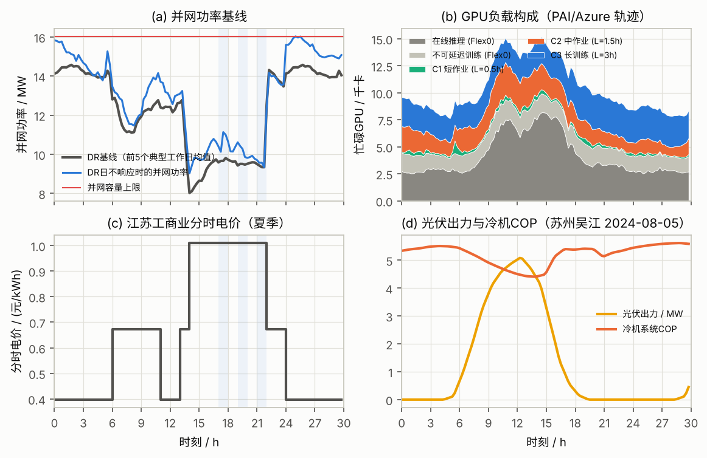

*图1 案例日输入。(a) 需求响应基线（前 5 个工作日均值）、不响应时的并网功率与并网容量上限；(b) GPU 负载构成（PAI 训练与 Azure 推理轨迹）；(c) 江苏工商业分时电价（夏季）；(d) 光伏出力与冷机 COP（苏州吴江，2024-08-05）。阴影为三次事件。*

### 5.2 主要参数（按设备 / 算力 / 市场 / 政策分组）

**设备**

| 参数 | 取值 | 标注 |
|---|---|---|
| GPU 数 / 节点峰值功率 / 空载比例 | 16 000 / 8.4 kW 每 8 卡 / 25% | [A]/[S][40]/[A] |
| 冷机 COP | 6.0−0.12(T−25)，限 3–7；DR 日 4.41–5.61；液冷敏感性 15−0.25(T−25) | [A] |
| 电储能 | 6 MW / 12 MWh，SOC 10%–95%，η=0.95/0.95，退化 60 元/MWh | [A]（退化成本的计法参考[41]） |
| 蓄冷罐 | 10 MWh$_{\rm th}$，4 MW$_{\rm th}$，η=0.98，损耗 0.5%/h | [A] |
| 燃气内燃机 + 吸收式制冷 | 3 MW，η$_e$=0.38，余热 0.45，爬坡 1.5 MW/15 min；COP 0.75，2.7 MW$_{\rm th}$ | [A] |
| 余热回收热泵 + 蓄热罐（可选，实验 24） | 3 MW$_{\rm el}$，COP 3.5（回水约 30 °C → 65 °C）；蓄热 0/20/40 MWh$_{\rm th}$，热损 0.5%/h；燃气锅炉效率 0.9；热需求 $0.3\max(18-T_t,0)$ MW$_{\rm th}$（案例日约 5.3 MW$_{\rm th}$） | [A]（COP 参考 [29]） |
| 光伏 | 8 MWp，PVWatts v5（温度系数 −0.37%/°C，系统损耗 14%） | [S][42] |
| 并网容量 $\bar P=\gamma\hat P$ | γ=1.10 → 16.03 MW（敏感性 1.0–1.3）；最小购电 1.5 MW | [A] |
| 机房热惯性（可选，实验 17） | 有效热容 2 MWh$_{\rm th}$/K，允许升温 3 K、预冷 2 K（ASHRAE A1 推荐 18–27 °C 内） | [A] |

**算力**

| 参数 | 取值 | 标注 |
|---|---|---|
| 负载构成 | 推理约 25%（Azure 形状），训练/批处理约 40%（PAI 形状），其中 75% 可延迟（C1/C2/C3） | [A]/[D] |
| SLA 滞后上界 $L_{1,2,3}$ | 0.5/1.5/3 h | [A]（由[10]换算） |
| 延迟成本 / 逾期罚价 | 0.5 / 1000 元/(GPU·h·h) | [A] |
| 期末积压价值 | 0.67 元/GPU·h（平段电价 672 元/MWh × 每 GPU·h 设施能耗 0.99 kWh） | 计算 |
| GPU 功率封顶（敏感性） | ρ=0.3，β=0.4，仅事件中 | [A]（参考[11,24]） |

**市场**

| 参数 | 取值 | 标注 |
|---|---|---|
| 分时电价 | 江苏 2025 夏季：峰 14–22 h（×1.8）、谷 0–6 h 与 11–13 h（×0.35）；形态敏感性见实验 16 | [S] |
| 补贴单价 | 3 元/kWh（日前），4.2 元/kWh（E3，提前 3 h），4.8 元/kWh（E3 不确定变体，提前 1 h）；敏感性 1–3 元/kWh | [S][9] |
| 有效性 / 补贴上限 | 平均削减 ≥80% 承诺（规划留 0.1 MW 裕度）/ ≤120% | [S][9] |
| 短缺考核 κ | 1.0×补贴单价（敏感性 0.5–2） | [A] |
| 天然气价格 | 3.6 元/Nm³（低位热值 9.89 kWh/Nm³） | [A] |
| 日前风险设定（实验 15） | SP；ℓ1 球 DRO，δ=0.1/0.2/0.4/0.8/1.2；场景鲁棒 δ=2；CVaR$_{0.8}$；均值–CVaR$_{0.9}$（w=0.5）；10 个历史联合场景 | — |

**政策与核算**

| 参数 | 取值 | 标注 |
|---|---|---|
| 反弹考核 $c^{\rm rb}$ | **政策参数**：0 与 3 元/kW·次两套口径，扫描 0–6 | [A] |
| PUE 上限（可选，实验 17） | 1.30 / 1.25 / 1.20（新建大型数据中心 ≤1.25，国家枢纽节点 ≤1.2） | [S] 数据中心绿色低碳发展专项行动计划（2024） |
| 绿电占比（可选，实验 17） | 60% / 80% / 90%（枢纽节点新建数据中心 >80%）；绿电环境溢价 30 元/MWh | [S]/[A] |
| 碳排放因子 | 电网 0.5617 tCO₂/MWh；天然气 56.1 t/TJ | [S][35]/IPCC 2006 |
| IR 固定分摊比例 α / 调优分摊 α\* | 0.41 / 日前回测（0.2–1.0） | 计算 |

### 5.3 扩展工况（实验 13–25）

| 实验 | 工况 |
|---|---|
| 13 虚实替代 | 电储能能量 3–24 MWh（功率 6 MW、绝对并网上限不变）× 统一承诺 5–9.5 MW；并网裕度 γ=1.0–1.3 × 承诺；完美信息；记录 JR 在事件前携带的积压能量（“虚拟储能”） |
| 14 计算效率 | 时域 H=24/48/72 步 × 场景 S=1/5/10，事件数 K=2/3/4；日前模型规模与时间 |
| 15 风险规避承诺 | 见 5.2 市场参数；每种承诺都在同一组 52 个蒙特卡洛日上由 JR-D 运行 |
| 16 电价形态 | 江苏分时（基准）、平电价、两段峰谷（峰 8–22 h，峰谷比 3）、含尖峰（19–21 h 为峰价 ×1.2）、鸭子曲线（谷 10–15 h，峰 17–23 h）；日均电价相同 |
| 17 多能耦合与政策 | 热惯性开/关 × 承诺 6–9 MW；绿电占比 0–90%；PUE 上限 1.20–1.30；联络线（购电）爬坡上限 4/2/1 MW 每 15 min（软约束）；热惯性开时 26 个蒙特卡洛日闭环 |
| 18 季节/气候 | 苏州冬季（2025-01-10，最低 −3.0 °C）、贵安夏季（国家枢纽节点，2024-07-26，最高 31.7 °C）；同一组算力轨迹与江苏规则；Open-Meteo ERA5 |
| 19 负荷与恢复模型 | PAI/Acme 负荷 × 流体/刚性作业恢复（$\tau_c$ 取各自轨迹），统一 6 MW；案例日（8 种策略）+ 52 个蒙特卡洛日（6 种策略）；每次运行都在作业级重放并重新结算 |
| 20 作业组合与开销 | 案例日；作业来源 PAI/Seren/Kalos、卡数放大 ×2/×4；开销：无、基准（检查点 1 min + 重启 5 min + 最短暂停 15 min）、慢（10 + 15 min，最短暂停 30 min）、仅周期检查点（30 min 一次，暂停时丢失上次检查点后的进度） |
| 21 绿电直连风电 | 绿电直连曲线：0–40 MW 无需求响应运行（53 日）；需求响应：风电装机 0/5/10/20 MW，每个运行日按当日风电预测重新求解日前耦合承诺与 IR-P 价格；案例日 + 26 个蒙特卡洛日 |
| 22 暂停开销与多档封顶 | $o_c=0.1$、0.42 h；单档 / 三档封顶；三档封顶 + 暂停开销；统一 6 MW，每种设定重新调优基准；案例日 + 26 个蒙特卡洛日 |
| 23 场景生成 | 分位 5 场景（基准）、K-means 5/10/20 场景（不均匀概率）、K-means + DRO（δ=0.4）；季节漂移：冬季案例日用夏季气象池建场景（SP 与 DRO δ=0.4/1.2）与用冬季气象池对比；样本外均由 JR-D 运行 |
| 24 冬季余热回收供热 | 冬季案例日 2025-01-10（日均 0.4 °C）；燃气锅炉供热 / 热泵无蓄热 / 热泵 + 20 MWh 蓄热 / 热泵 + 40 MWh 蓄热；并网容量固定在无供热时的值；统一 6 MW，每种设定重新调优基准；案例日 + 26 个最冷的冬季运行日 |
| 25 可交付能力域 | 案例日三次事件全部调用；基准（间隔 1 h，γ=1.10）与收紧（间隔 0.5 h，γ=1.00）两种工况；单纯形上 91 条射线 × JR / IR-O\*（每条射线取事后最优分摊）/ IR-O / IR-P（求解器响应）/ IR-P+（最有利的价格响应）；$C_3$ 固定的截面；间隔 0–3 h × γ=1.00/1.05/1.10；52 个运行日；完美信息，按平均削减足额交付 |

### 5.4 作业级验证仿真器（审稿意见 6f）

流体模型把每类可延迟负载看作可任意分割的“流体”。为检验这一近似，本文把每次闭环运行的结果交给一个作业级执行器重放，并按江苏规则重新结算（`src/job_gen.m`、`src/job_replay.m`）：

1. **作业生成。** 从轨迹的“卡数—时长”联合分布中逐个抽取作业：预热起点按平稳分布（按“个数 × 时长”加权，年龄均匀）生成在运作业；之后每当该类名义占用低于目标曲线半个作业（大于该类负荷的作业取半个负荷）且累计亏欠允许时，开始下一个作业。这样名义占用在约半个作业的误差内跟随案例日的流体曲线，长期均值一致。随机数用平台无关的 Park–Miller 生成器，MATLAB 与 Octave 结果相同。
2. **执行。** 每 15 min 把流体解中各类相对名义负荷的偏差 $y_{c,t}-a_{c,t}/\Delta t$ 加到逐分钟的作业级名义占用上，作为该类的目标忙碌卡数。作业按“松弛度”（完成截止时刻 = 名义结束 + $L_c$，减去当前时刻与剩余所需时间）排序：松弛度不足一个时段的作业无论目标如何都必须运行；其余作业先按类目标、再按总目标回填。事件时段与反弹窗口内总忙碌卡数不超过目标（保证削减），其余时段取最接近目标的作业组合。作业是刚性的：整组运行、名义速度、不可加速。
3. **开销。** 计划暂停前写检查点（损失 $t^{\rm ck}$ 的进度，卡仍在耗电），恢复后重启 $t^{\rm rs}$（耗电不产出），暂停至少 $t^{\min}$；或不在暂停时写检查点、丢失上次周期检查点后的进度（均匀分布于 0–30 min）。取值依据：异步/分层检查点已把 13–30B 模型的保存时间降到 20–50 s[43]，内存检查点使故障恢复快 13 倍以上[44]，Acme 的异步检查点把 7B/123B 模型的检查点开销降低 3.6–58.7 倍[39]；“慢”工况（同步检查点 10 min、重启 15 min）为假设，代表不支持异步保存的大模型作业。
4. **结算。** 作业级忙碌卡数相对流体解的偏差换算为 IT 功率，冷量偏差由电制冷承担，储能与内燃机按流体解运行，得到作业级购电功率、积压与逾期量，再用同一结算程序计算有效性、补贴、反弹考核、能量与延迟成本。

统计量包括：购电功率跟踪误差（RMSE）、计划补算中未能执行的部分、暂停次数与开销电量、每个作业的最大滞后与 $L_c$ 之比、1 min 内可延迟 IT 功率的最大阶跃、被暂停的最大作业的功率。Choukse 等（2025）[14] 指出大型训练作业在计算与通信阶段交替，功率摆动的幅度随作业规模增大，其频谱若与电网关键频率重合会损害电网设施。这发生在秒级、迭代尺度，本文 15 min 的调度不涉及。整组暂停/恢复造成的阶跃由 1 min 阶跃统计与 IT 爬坡约束（实验 10）覆盖。

---

# 第 6–7 节与摘要（修订稿，基准修正后的正式结果）

> 数字均来自 `python3 tools/summarize_results.py`（GNU Octave 8.4 + glpk 的正式运行）。独立基准的 IT 功率预算已计入燃气内燃机可调出力（见 4.3 节），全部相关实验已按新代码重跑。

## 6 结果与讨论

### 6.1 机理与理论验证（实验 1、实验 11）

设置两个事件：前序事件 A 自 17:00 开始，后续事件 B 在间隔 τ 后开始；比较 B 的最大可维持削减 $\Gamma_B$ 与其单事件能力 $\Gamma_B^0$ 之比（图 2）。

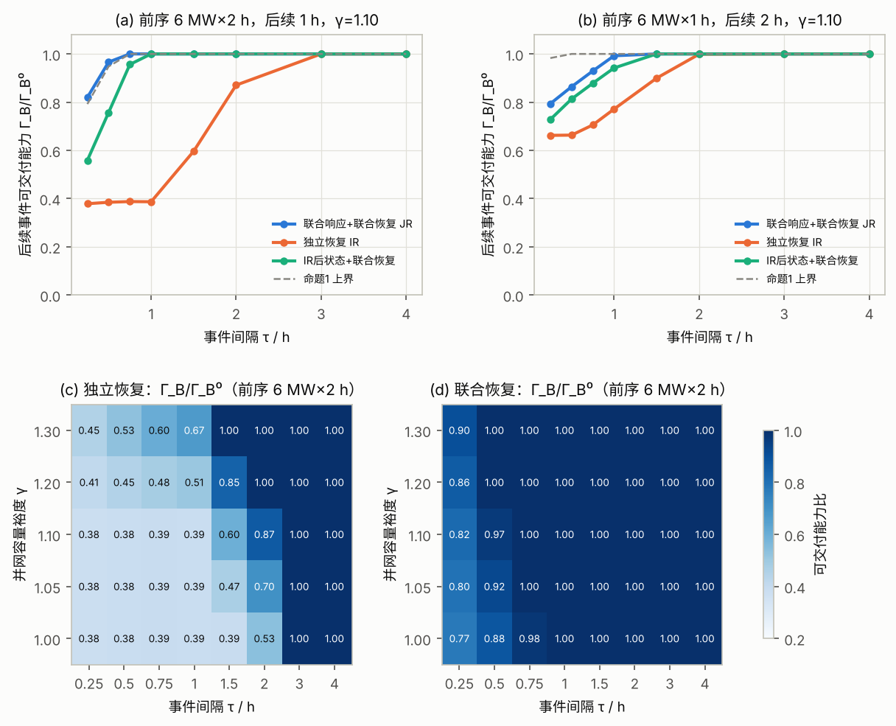

*图2 (a)(b) γ=1.10 时后续事件可交付能力比随间隔的变化；(c)(d) 独立恢复与联合恢复在 τ–γ 平面上的可交付能力比（前序 6 MW×2 h）。*

**表1 前序 6 MW×2 h、后续 1 h、γ=1.10 时的可交付能力比 $\Gamma_B/\Gamma_B^0$**

| 间隔 τ/h | 恢复通道能量 H/MWh | 独立恢复 IR | 同一事后状态 + 联合恢复 | 联合响应 + 联合恢复 JR | 命题 1 上界 |
|---|---|---|---|---|---|
| 0.25 | 1.65 | 0.38 | 0.56 | 0.82 | 0.79 |
| 0.50 | 3.28 | 0.38 | 0.76 | 0.97 | 0.95 |
| 0.75 | 4.91 | 0.39 | 0.96 | 1.00 | 1.00 |
| 1.00 | 6.55 | 0.39 | 1.00 | 1.00 | 1.00 |
| 1.50 | 9.80 | 0.60 | 1.00 | 1.00 | 1.00 |
| 2.00 | 13.02 | 0.87 | 1.00 | 1.00 | 1.00 |

（事件 A 结束时：算侧积压 4.9 MWh，储侧缺口 12.3 MWh，$\Gamma_B^0\approx8.0$ MW。上界按独立恢复的事后状态计算，故“联合响应 + 联合恢复”可略高于它。）

1. **独立恢复必须“还清全部欠账”**：τ≤1 h 时 B 只能交付单事件能力的 38%–39%，τ=2 h 才回到 87%。
2. **联合恢复只偿还下一事件需要的部分**：同一事后状态下 τ=0.75 h（通道能量仅为总欠账的 29%）即恢复到 96%；若前序响应也联合规划，τ=0.5 h 就达到 97%。
3. **命题 1 上界在 80 个工况中全部成立**（同一事后状态下的最优值从不超过上界），47 个工况与最优值相差 <0.05 MW；偏松的工况集中在 τ≤0.5 h，原因见 [`理论推导.md`](理论推导.md) 第 1 节“紧性”。
4. **定理 1 的闭式解**（[`理论推导.md`](理论推导.md) 第 2 节）：
   - 简化模型（$p_f=5$ MW，$X=5$ MWh，$h=3$ MW）中，$L=1/1.5/2/3$ h 时最小全恢复间隔差为 0/0.83/1.67/1.67 h，与 $\min(X,p_f(L-D_B))/h$ 完全一致；
   - 68 个工况中闭式解与离散时间 LP 的最大偏差为 $1\times10^{-5}$ MW，即 glpk 的求解精度（图 12）。
   - $L=1$ h（=事件 B 时长）时联合恢复没有价值，验证了推论 1(a)。
5. 后续事件更长时（前序 1 h、后续 2 h），能量型约束更突出：γ=1.10、τ≤1 h 时 IR 为 0.66–0.77，同一事后状态的联合恢复为 0.73–0.94，JR 为 0.79–0.99。

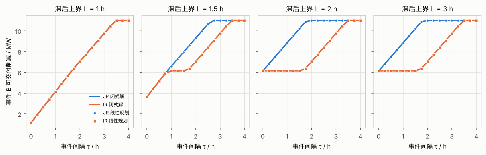

*图12 定理 1：闭式解（线）与离散时间 LP（点）。*

### 6.2 案例日：相同承诺下的闭环对比（实验 2）

所有策略使用相同的承诺、相同的 SLA 与物理约束，按江苏规则结算；均为 15 min 滚动（JR-S 为场景 MPC，JR-oracle 为完美信息参考）。承诺取两种：

- **耦合日前承诺**：$c^{\rm rb}$=3 时为 3.27/6.65/7.90 MW——E3 补贴单价最高，日前模型主动少承诺 E1，把恢复通道留给 E3；$c^{\rm rb}$=0 时为 8.18/7.98/7.90 MW，与单事件能力评估相同。
- **统一 6 MW**。

**表 案例日结果（兑现率 / 有效次数 / 最大反弹 MW / 综合成本 万元）**

| 承诺与口径 | IR-O\* | IR-P | JR-M | **JR-D** | JR-S | 完美信息 |
|---|---|---|---|---|---|---|
| 耦合承诺，$c^{\rm rb}$=3 | 100% / 3 / 6.39 / 24.35 | 100% / 3 / 4.16 / 23.31 | 86.0% / 2 / 6.44 / 28.01 | **99.9% / 3 / 5.02 / 22.71** | 100% / 3 / 3.48 / 22.76 | 22.66 |
| 统一 6 MW，$c^{\rm rb}$=3 | 100% / 3 / 6.45 / 24.57 | 96.6% / 3 / 4.37 / 23.61 | 92.4% / 2 / 6.44 / 26.42 | **100% / 3 / 5.77 / 22.84** | 100% / 3 / 4.77 / 22.85 | 22.80 |
| 耦合承诺，$c^{\rm rb}$=0 | 80.3% / 2 / — / 22.70 | 73.7% / 1 / — / 24.70 | 84.4% / 2 / — / 24.60 | **99.3% / 3 / — / 19.13** | 99.6% / 3 / — / 19.12 | 19.04 |
| 统一 6 MW，$c^{\rm rb}$=0 | 100% / 3 / — / 19.97 | 92.6% / 3 / — / 20.42 | 99.8% / 3 / — / 20.81 | **100% / 3 / — / 19.34** | 100% / 3 / — / 19.36 | — |

（$c^{\rm rb}$=0 时所有策略事后都会把购电抬到并网上限附近，最大反弹均为 6.52 MW，故不列出。）

1. **承诺接近单事件能力时，联合恢复的价值最大。**
   - 规则口径、耦合承诺下，JR-D 三次事件全部有效（兑现 99.3%）。最强独立基准 IR-O\* 只兑现 80.3%，E2 无效。
   - JR-D 综合成本比 IR-O\* 低 15.7%，比 IR-P 低 22.5%。
   - 原因见图 18、图 19。JR-D 在 E2 中更多推迟长时限任务：E3 开始时积压达 6027 GPU·h，约合 10 MWh 电量。E2→E3 间隔的通道主要用于电/冷储能回充（5.6 + 0.8 MWh），积压携带过 E3 后再补算。
   - IR-O\* 的三个间隔几乎全部用于补算（14.1 MWh），储能只回充 0.3 MWh。E2 中它的 EMS 放弃有效性（只交付 4.76 MW），把电储能留给补贴更高的 E3；IR-P 的 E2 只交付 3.40 MW。
2. **承诺适中（统一 6 MW）时，各策略都能兑现。** JR-D 的成本优势降为 3.2%（对 IR-O\*，规则口径）至 3.3%（对 IR-P，反弹定价口径）。
3. **反弹定价口径下，成本优势主要来自反弹考核。** 对 IR-P 的 −2.6%/−3.3% 中，不计反弹考核的部分只有 +1.1%/−0.6%。这与第 6.6 节一致：反弹考核把事后的通道变贵，联合恢复把补算挪到通道便宜的时段。
4. **价格协调不能代替联合恢复。** IR-P 在反弹定价口径下是最强基准，但在规则口径的高承诺工况中最差（73.7%）。日前一次性下发的通道价格在实际状态偏离计划时不再正确，LP 最优响应不唯一也会使 IT 侧再次挤占通道（命题 2 的含义）。
5. **跨事件远见是关键。** 逐事件联合 JR-M 只看当前与下一个事件，在三种工况中兑现 84%–92%，成本比 JR-D 高 8%–19%。
6. **场景 MPC 与完美信息的差距都很小。** JR-S、JR-oracle 与 JR-D 的成本差在 0.5% 以内。案例日的预测误差不大；E3 调用不确定时的差别见第 6.3 节。

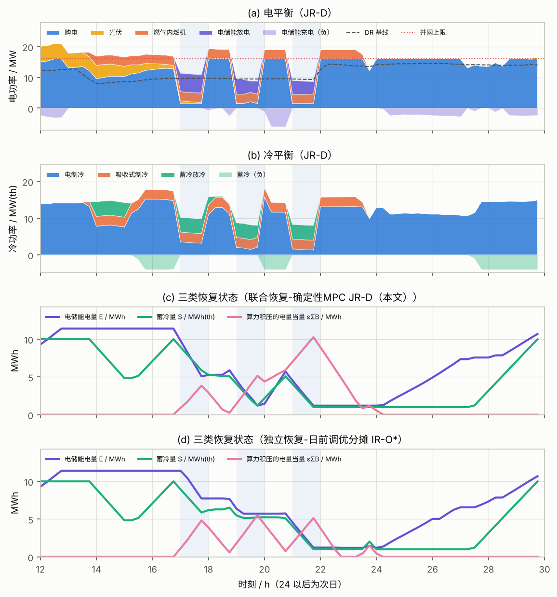

*图18 案例日（规则口径、耦合承诺 8.18/7.98/7.90 MW）：(a) 电平衡；(b) 冷平衡；(c)(d) JR-D 与 IR-O\* 的三类恢复状态（电储能、蓄冷、积压的电量当量 $\varepsilon\sum_cB_c$）。*

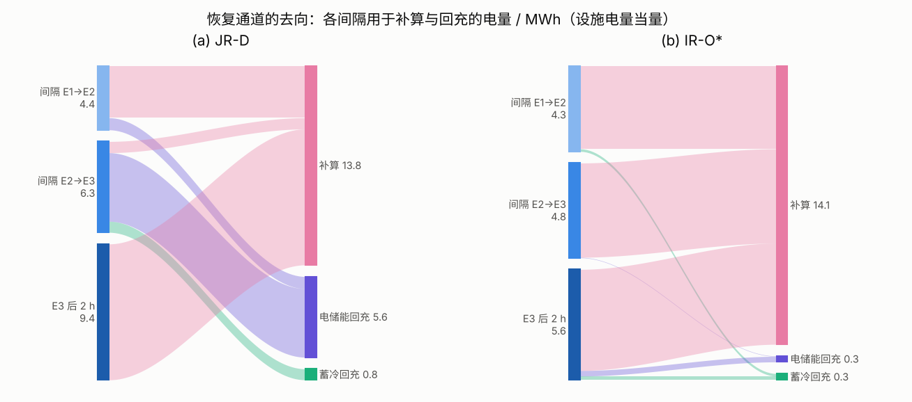

*图19 同一工况下，各事件间隔与 E3 后 2 h 内，恢复通道用于补算、电储能回充与蓄冷回充的电量。*

### 6.3 52 个运行日蒙特卡洛（实验 4）

承诺统一取 6 MW；日前确定的基线、场景、α\* 与 IR-P 价格信号不随实现变化。表中为均值，括号内为 95% 置信区间；策略间比较用逐日配对差（均值与 95% 置信区间）和 Wilcoxon 符号秩检验。三种设定下 52 天成本的完整分布见图 24（山脊图，原图 7 的升级）：JR-D 的分布整体左移，右尾也最短。

**表 事件确定、$c^{\rm rb}$=3 元/kW（N=52）**

| 策略 | 兑现率 / % | 三次全有效的天数占比 | 最大反弹 / MW | 综合成本 / 万元 |
|---|---|---|---|---|
| IR-R | 71.1 [66.4, 75.7] | 11.5% | 6.52 | 30.25 [29.18, 31.33] |
| IR-O | 81.6 [76.9, 86.2] | 48.1% | 6.28 | 26.00 [24.91, 27.09] |
| IR-O\* | 97.8 [96.5, 99.1] | 90.4% | 6.22 | 24.30 [23.45, 25.15] |
| IR-P | 98.3 [96.7, 99.9] | 94.2% | 5.30 | 23.20 [22.46, 23.94] |
| JR-M | 91.7 [89.6, 93.8] | 48.1% | 6.35 | 24.81 [23.78, 25.84] |
| **JR-D** | **99.9 [99.7, 100]** | **100%** | **4.85** | **22.53 [21.79, 23.27]** |

逐日配对（JR-D − 基准）：

- 对 IR-P：成本 −6692 元/日 [−7891, −5492]（−2.9%，p=4×10⁻¹⁰，52 天中 50 天更便宜），最大反弹 −8.4%，兑现率 +1.6 个百分点。
- 对 IR-O\*：成本 −7.3%（52/52 天），最大反弹 −22.0%，兑现率 +2.1 个百分点。
- 对 JR-M：成本 −9.2%（52/52 天），兑现率 +8.2 个百分点。
- 不计反弹考核时，对 IR-P 的成本差为 −0.7%，不显著（p=0.64）；对 IR-O\* 为 +0.9%。

**表 事件确定、$c^{\rm rb}$=0（只按江苏细则结算，N=52）**

| 策略 | 兑现率 / % | 三次全有效的天数占比 | 综合成本 / 万元 |
|---|---|---|---|
| IR-O\* | 99.2 [98.5, 99.9] | 98.1% | 19.71 [19.07, 20.35] |
| IR-P | 93.3 [90.7, 96.0] | 86.5% | 20.21 [19.42, 20.99] |
| JR-M | 94.6 [92.5, 96.6] | 67.3% | 21.38 [20.39, 22.36] |
| **JR-D** | **99.9 [99.7, 100]** | **100%** | **19.10 [18.54, 19.67]** |

- 只按江苏细则结算时，JR-D 对 IR-O\* 成本 −3.1%（−6062 元/日 [−7053, −5072]，52/52 天更便宜，p=4×10⁻¹⁰），对 IR-P −5.5%。
- 所有策略事后都会把购电抬到并网上限附近，最大反弹没有差别（6.5 MW）。

**表 E3 以 0.6 的概率被调用、提前 1 h 确认（$c^{\rm rb}$=3，N=52）**

| 策略 | 兑现率 / % | 三次全有效 | 综合成本 / 万元 | E3 被调用日 / 未调用日的成本 |
|---|---|---|---|---|
| IR-O\* | 98.2 | 94.2% | 24.26 | 23.90 / 24.80 |
| IR-P | 97.6 | 94.2% | 23.67 | 22.62 / 25.23 |
| JR-M | 94.9 | 67.3% | 24.10 | 24.77 / 23.11 |
| JR-D | 99.98 | 100% | 22.74 | 22.07 / 23.72 |
| JR-S（场景树） | 99.7 | 100% | 22.65 | 22.30 / 23.18 |
| 完美信息 | 100.0 | 100% | 22.27 | 21.92 / 22.80 |

- JR-D 对 IR-P −4.0%（51/52 天更便宜），对 IR-O\* −6.3%。
- **场景 MPC 的增益很小。** JR-S 比 JR-D 低 0.4%（−821 元/日 [−2064, +421]），不显著（p=0.46）。原因是它在 E3 未被调用的日子里多省了 5400 元，在被调用的日子里多花了 2300 元。场景树用一部分已调用日的收益，换取了对“不调用”的对冲。
- JR-D 与完美信息相差 2.1%，其中大部分是反弹考核：不计反弹考核时只差 0.2%（p=0.43）。

**小结。** 修正后的独立基准（尤其是价格协调的 IR-P）已相当强。联合恢复在三组设定下仍然每天全部有效，并在 50–52 个运行日中更便宜。相对每组中最强的基准，成本优势为 2.9%–4.0%：反弹定价口径下主要来自反弹考核，只按江苏细则结算时主要来自多拿的补贴（见 6.9 节）。

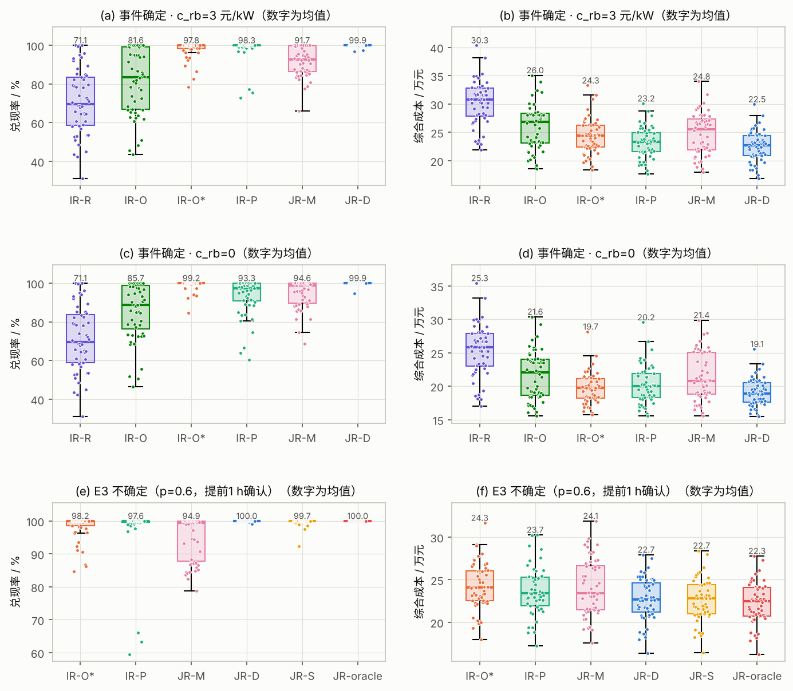

*图7 52 个运行日的兑现率与综合成本分布（数字为均值）。*

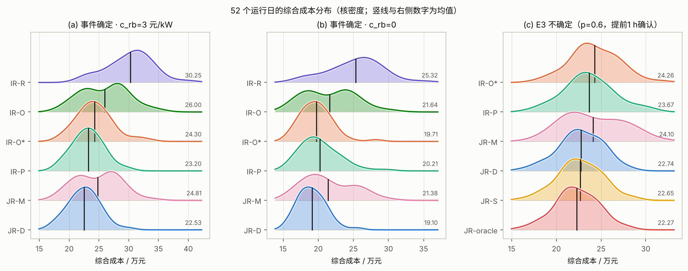

*图24 三种设定下 52 个运行日综合成本的核密度（竖线与右侧数字为均值）。*


### 6.4 可靠可交付容量与虚实替代（实验 12、13）

**闭环下的可靠可交付容量（实验 12）。** 规则口径下，对统一承诺 4–9 MW 各运行 20 个蒙特卡洛日（闭环、确定性预测）。

| 承诺 / MW | IR-O\* 全有效 / 成本 | IR-P 全有效 / 成本 | **JR-D 全有效 / 成本** |
|---|---|---|---|
| 4 | 75% / 21.63 | 85% / 21.42 | **100% / 20.69** |
| 5 | 80% / 20.83 | 75% / 21.05 | **100% / 19.75** |
| 6 | 95% / 19.70 | 80% / 20.27 | **100% / 19.05** |
| 7 | 80% / 20.32 | 70% / 20.34 | **95% / 18.89** |
| 8 | 50% / 21.38 | 40% / 21.65 | **95% / 19.20** |
| 9 | 25% / 22.97 | 25% / 23.42 | 65% / 21.01 |

（成本单位：万元/日。）

- 在“≥95% 运行日三次全部有效”的要求下（图 11），IR-O\* 只能承诺 6 MW，IR-P 在任何承诺水平都达不到，JR-D 可承诺 8 MW（+33%）。
- 各自的最优承诺下，JR-D（7 MW，18.89 万元/日）比 IR-O\*（6 MW，19.70 万元/日）低 4.1%。

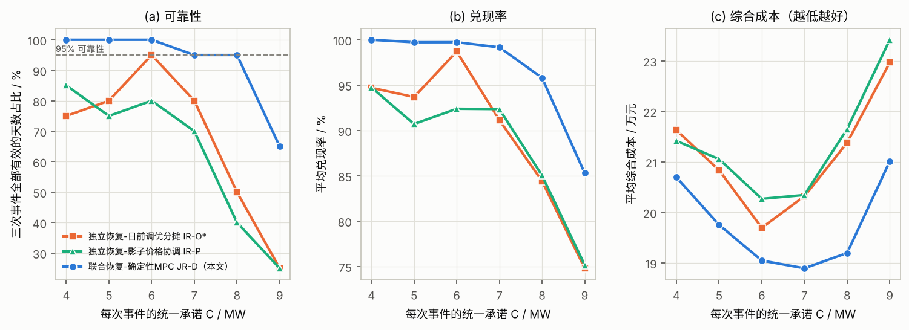

*图11 闭环可靠性、兑现率与综合成本随统一承诺的变化（规则口径，20 个运行日）。*

**虚实替代（实验 13，完美信息，规则口径）。** 扫描电储能能量（功率 6 MW、绝对并网上限不变）与并网裕度 γ，求“≥99% 兑现且三次全有效”的最大统一承诺。

| 电储能能量 / MWh | 3 | 6 | 9 | 12 | 15 | 18 | 24 |
|---|---|---|---|---|---|---|---|
| JR | 6.5 | 7.0 | 7.5 | **8.0** | 7.5 | 7.0 | 6.5 |
| IR-O\*（事后最优 α） | — | 5.0 | 6.0 | 6.5 | 7.0 | 7.0 | 6.5 |
| IR-P | — | 5.0 | 5.5 | 6.0 | 5.0 | — | — |
| JR 携带进 E3 的积压（电量当量）/ MWh | 6.8 | 7.0 | 7.0 | 6.0 | 3.5 | 0.8 | 0 |

| 并网裕度 γ | 1.00 | 1.05 | 1.10 | 1.15 | 1.20 | 1.30 |
|---|---|---|---|---|---|---|
| JR | 7.0 | 7.5 | **8.0** | 8.0 | 8.0 | 8.0 |
| IR-O\* | 6.0 | 6.0 | 6.5 | 6.5 | 7.0 | 8.0 |
| IR-P | 5.0 | 5.5 | 6.0 | 7.0 | 6.0 | 6.0 |

（“—”表示扫描范围 5–9.5 MW 内达不到。）

1. **联合恢复约等于 9–12 MWh 电储能。**
   - JR 配 3 MWh 电池可靠承诺 6.5 MW，IR-O\* 要 12 MWh 才达到。
   - JR 配 6 MWh 电池可靠承诺 7.0 MW，IR-O\* 要 15–18 MWh。
   - JR 配 12 MWh 电池可靠承诺 8.0 MW，任何电池规模下独立恢复都达不到。
2. **联合恢复约等于 2.9 MW 并网容量。** JR 在 γ=1.10 时达到 8.0 MW，IR-O\* 要 γ=1.30，即多 0.2×14.57≈2.9 MW 并网容量；γ=1.00 时 JR 的 7.0 MW 同样需要 IR-O\* 把 γ 提到 1.20。
3. **虚拟储能的规模。** 在可靠容量处，JR 把 6.0–7.0 MWh 当量的长时限积压携带进 E3，约为 12 MWh 电池的一半（图 14c）。电池越小，算力虚拟储能被用得越多。电池 ≥18 MWh 时，物理储能已足够，联合恢复不再需要它。
4. **基线效应：电池并非越大越好。**
   - 电池超过 12–15 MWh 后，所有策略的可靠容量都下降。原因是常态运行时，大电池在峰段放电做峰谷套利，压低了“前 5 日平均”的需求响应基线。电池每增加 6 MWh，事件时段基线下降约 0.6 MW（E1：6 MWh 时 10.28 MW，24 MWh 时 8.47 MW）。
   - 相对基线可削减的空间因此缩小。这提醒需求响应合同设计：常态峰谷套利会侵蚀基线，配储规模与基线规则需要一并考虑。

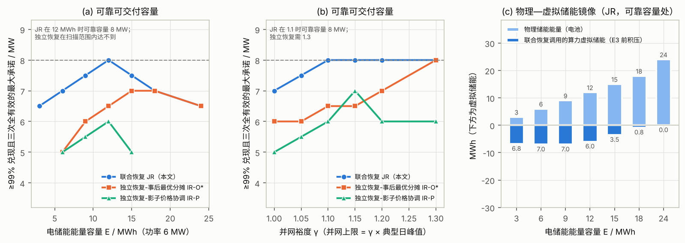

*图14 (a)(b) 可靠可交付容量随电储能能量与并网裕度的变化（虚线为 JR 在基准配置下的可靠容量）；(c) 物理储能与联合恢复调用的算力虚拟储能（E3 前积压的电量当量）。*

### 6.5 日前承诺：配对与风险规避（实验 6、15）

**承诺—运行配对（实验 6，案例日 + 20 个运行日）。** 三种承诺：单事件能力评估（SE）、按回测缩放的单事件评估（SE-θ，θ\*=0.8，代表谨慎的传统做法）、耦合日前承诺（DA）。每种承诺分别由 IR-O\*（α 按该承诺重新调优）和 JR-D 运行。

| 承诺（合计 MW） | 口径 | IR-O\* 兑现 / 全有效 / 成本 | **JR-D 兑现 / 全有效 / 成本** |
|---|---|---|---|
| SE 8.18/7.98/7.90（24.1） | $c^{\rm rb}$=3 | 81.8% / 45% / 25.63 | 96.0% / 95% / 23.06 |
| SE-θ 6.54/6.38/6.32（19.2） | $c^{\rm rb}$=3 | 97.5% / 95% / 24.08 | 99.9% / 100% / 22.44 |
| DA 3.27/6.65/7.90（17.8） | $c^{\rm rb}$=3 | 97.0% / 100% / 23.79 | **98.8% / 100% / 22.39** |
| SE = DA 8.18/7.98/7.90 | $c^{\rm rb}$=0 | 84.3% / 45% / 21.43 | 96.0% / 95% / 19.18 |
| SE-θ 6.54/6.38/6.32 | $c^{\rm rb}$=0 | 98.2% / 95% / 19.60 | **99.7% / 100% / 18.85** |

（20 个运行日均值；成本单位万元/日。）

- **传统做法与本文方法的差距。** 单事件评估 + 独立恢复（SE｜IR-O\*）是现行做法，20 天中只有 45% 的日子三次全有效。耦合承诺 + 联合恢复（DA｜JR-D）每天全部有效，成本低 12.6%。
- **两部分各自的贡献。** 只把承诺换成 DA（DA｜IR-O\*）可降低 7.2%。在 DA 承诺下再把运行换成 JR-D，再降 5.9%。
- **反弹定价口径下，耦合模型会主动少承诺 E1。** E3 补贴单价最高，日前模型把恢复通道留给 E3。
- **规则口径下，耦合承诺与单事件评估相同。** 二者都承诺到单事件能力，此时按 θ\*=0.8 缩放的承诺对两种运行策略都更好。原因是 5 个日前场景对运行日的高负荷尾部覆盖不足。实验 15 在反弹定价口径下用分布鲁棒承诺处理这一问题。

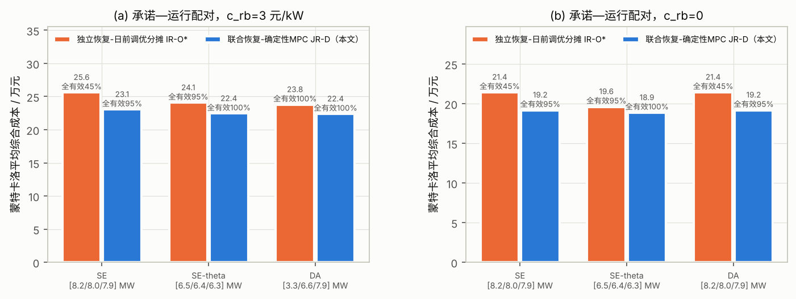

*图9 承诺—运行配对的蒙特卡洛平均成本（标注为全有效天数占比）。*

**风险规避承诺（实验 15，$c^{\rm rb}$=3，10 个历史联合场景，命题 3）。** 每种风险设定给出一组承诺，再由 JR-D 在同一组 52 个运行日上样本外运行。

| 设定 | 承诺 E1/E2/E3（合计）/ MW | 样本外均值 / 万元 | 最差 10% 日均值 / 万元 | 全有效 |
|---|---|---|---|---|
| SP（δ=0） | 3.66/6.34/7.90（17.9） | 22.50 | 27.33 | 100% |
| DRO δ=0.2 | 2.66/6.01/7.90（16.6） | 22.47 | 27.27 | 100% |
| DRO δ=0.4 | 2.80/5.06/7.90（15.8） | 22.45 | 27.24 | 100% |
| **DRO δ=1.2** | 0.96/5.77/7.90（14.6） | **22.44** | **27.22** | 100% |
| 场景鲁棒（δ=2） | 4.54/2.17/7.90（14.6） | 22.45 | 27.22 | 100% |
| CVaR$_{0.8}$ | 4.22/2.50/7.90（14.6） | 22.45 | 27.22 | 100% |
| 均值–CVaR$_{0.9}$（w=0.5） | 2.74/5.50/7.90（16.1） | 22.46 | 27.26 | 100% |
| 单事件能力评估 | 8.18/7.98/7.90（24.1） | 23.11 | 29.12 | 96.2% |

1. **保守度越高，承诺合计越少。** δ 由 0 增到 0.8，合计承诺由 17.9 MW 单调降到 14.7 MW，之后不再变化。补贴最高的 E3 始终承诺到能力上限 7.9 MW，减少的是 E1、E2。E1、E2 之间的分配近乎无差异，因此不唯一（图 15b）。
2. **分布鲁棒承诺在样本外同时降低均值与尾部。**
   - 与 SP 相比，δ=0.4–1.2 的均值低 0.21%–0.26%，最差 10% 日的均值低 0.3%–0.4%。逐日配对差均显著（Wilcoxon p≤2×10⁻⁴）。
   - δ=1.2 在两个指标上都最好，是非支配点，即帕累托“膝点”（图 15a）。
   - 原因是 10 个历史场景对运行日的高负荷尾部覆盖不足：SP 承诺偏多，在不利日子里补贴少、考核多；鲁棒承诺少承诺 E1/E2，减少了这类损失。
   - 改进幅度不大，说明耦合承诺 + 联合恢复本身已相当稳健。
3. **耦合承诺远优于传统单事件评估。** 单事件评估在样本外贵 2.7%，最差 10% 日贵 6.6%，全有效天数只有 96.2%。
4. **计算代价小。** 分布鲁棒模型只增加 21 个连续变量和 30 个约束，10 个场景下求解 14–25 s（SP 为 10 s）。

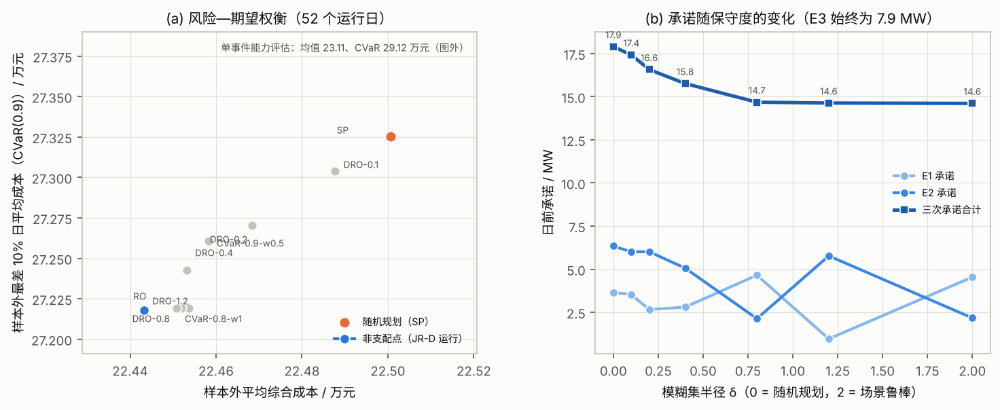

*图15 (a) 各风险设定在 52 个运行日上的样本外均值与最差 10% 日均值（单事件评估在图外）；(b) 承诺随模糊集半径 δ 的变化。*

### 6.6 影子价格：恢复通道的稀缺性（实验 5）

在完美信息、统一 6 MW 承诺下，固定最优 0–1 变量后重解 LP 取对偶（`exp5_shadow*.csv`），时序见图 8。

**表 影子价格（元/MWh；积压为元/GPU·h）**

| 口径 | 时段 | 通道价格 $\lambda_t$ | 其中并网约束 $\lambda^{\rm cap}$ | 其中反弹考核 $\lambda^{\rm rb}$ | 储能价值 $\nu$ | C1/C2/C3 积压边际成本 |
|---|---|---|---|---|---|---|
| γ=1.10，$c^{\rm rb}$=3 | 间隔 1 / 间隔 2 | 4010 / 4010 | 0 / 0 | 3000 / 3000 | 4223 | 3.94/3.94/3.94；3.92/3.88/3.69 |
| γ=1.10，$c^{\rm rb}$=3 | E3 | 4505 | 0 | 0 | 4223 | 4.38/3.43/**3.19** |
| γ=1.10，$c^{\rm rb}$=0 | 间隔 1 / 间隔 2 | 2464 / 2270 | **1455 / 1260** | 0 | 2657 / 2522 | 2.49；2.22 |
| γ=1.00，$c^{\rm rb}$=0 | 间隔 1 / 间隔 2 | 3252 / 2781 | **2242 / 1771** | 0 | 3285 / 3060 | 3.16；2.72 |

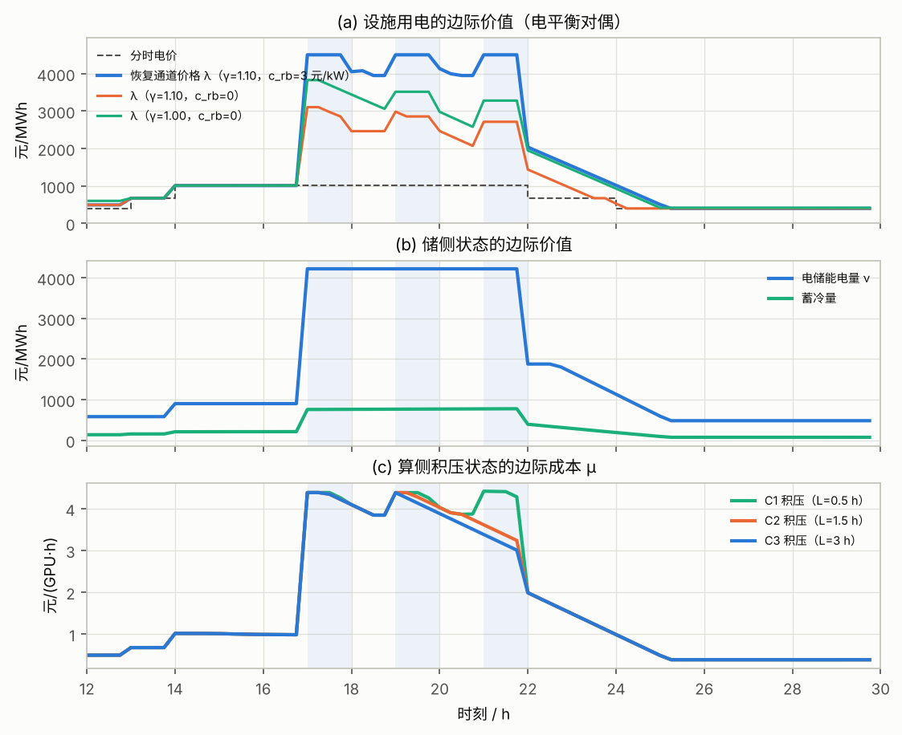

*图8 (a) 设施用电的边际价值（通道价格）；(b) 储能状态的边际价值；(c) 各类积压的边际成本。*

1. **回应审稿意见 1b：不设反弹考核时，物理并网约束本身就在事件间隔内形成通道竞争。** $c^{\rm rb}=0$、γ=1.10 时，间隔内并网约束的影子价格为 1260–1455 元/MWh（γ=1.00 时 1771–2242 元/MWh），通道价格是峰时电价的 2.2–3.2 倍。设置反弹考核时，起作用的约束换成了反弹窗口（3000 元/MWh），并网约束不再紧。
2. **命题 2（单一通道价格）的数值验证：**
   - 在 4 种组合的全部内点充电、放电与补算时刻，$\eta_c\nu_t=\lambda_t+c^{\rm deg}$、$\nu_t/\eta_d=\lambda_t-c^{\rm deg}$、$\mu_{c,t}=\varepsilon_t\lambda_t$ 的最大残差为 $2\times10^{-12}$（`exp5_kkt*.csv`）。
   - 例：间隔 1 内 $\mu=3.94$ 元/GPU·h，除以 $\varepsilon\approx0.99$ kWh/GPU·h 约为 $4.0\times10^3$ 元/MWh，与通道价格一致。
3. **长时限积压最“便宜”**：进入 E3 后 C3 积压的边际成本（3.19）明显低于 C1（4.38），因为其截止时间在 E3 之后——通道先给储能回充与短时限补算，长时限任务跨事件携带（定理 1 多类推广）。

### 6.7 敏感性（实验 3，完美信息、基准取事后最优）

完美信息下，IR-O\* 取**事后最优**的静态分摊比例，IR-P 取完美信息影子价格，使基准尽可能强。图 5、图 6 给出 4 个维度与 τ×γ 平面的结果。

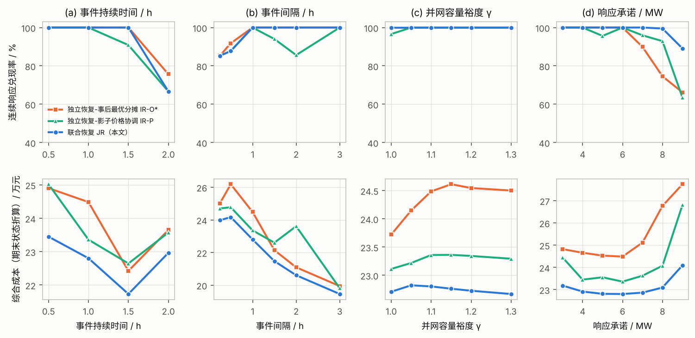

*图5 上：兑现率；下：综合成本（$c^{\rm rb}$=3 元/kW）。规则口径见 `fig05_sensitivity_crb0.png`。*

**表 承诺水平扫描（兑现率 / 综合成本，万元）**

| 统一承诺 | 口径 | IR-O\*（事后最优 α） | IR-P | **JR** | JR 相对最强基准 |
|---|---|---|---|---|---|
| 6 MW | $c^{\rm rb}$=0 | 100% / 19.91 | 100% / 19.92 | 100% / 19.31 | −3.0% |
| 7 MW | $c^{\rm rb}$=0 | 92.1% / 20.43 | 88.8% / 20.60 | **100% / 19.04** | −6.8% |
| 8 MW | $c^{\rm rb}$=0 | 79.8% / 22.27 | 77.7% / 22.23 | **99.5% / 19.09** | −14.1% |
| 9 MW | $c^{\rm rb}$=0 | 71.6% / 23.23 | 69.0% / 23.25 | 89.1% / 20.06 | −13.7% |
| 8 MW | $c^{\rm rb}$=3 | 74.5% / 26.76 | 92.9% / 24.07 | **99.5% / 23.09** | −4.1% |

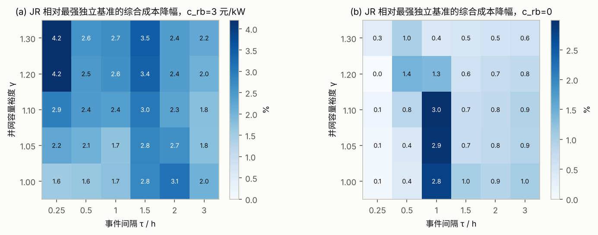

*图6 τ–γ 平面上 JR 相对最强独立基准（IR-O\*、IR-P 中更便宜者）的综合成本降幅。*

1. **可交付容量是联合恢复的主要价值。**
   - 在 ≥99% 兑现要求下，事后最优的独立恢复只能承诺约 6 MW/次，JR 可承诺约 8 MW/次（+33%）。
   - 承诺 8 MW 时，JR 兑现 99.5%，最强独立基准不足 80%（规则口径），JR 成本低 14.1%。
2. **承诺适中（6 MW）时，优势只有 2%–3%。**
   - τ–γ 平面上，规则口径的降幅为 0%–3.0%，峰值在 τ=1 h、γ≤1.10（2.8%–3.0%）。间隔 ≤0.5 h 或 ≥1.5 h 时普遍 ≤1.4%。
   - 反弹定价口径下降幅为 1.6%–4.2%，任何工况都不劣于最强基准。
   - 定理 1 推论 1 解释了“优势随通道宽度先升后降”：通道过窄时两种策略都恢复不了，过宽时都能恢复。
3. **兑现率不是联合恢复优化的目标。**
   - 间隔 τ=0.5 h、$c^{\rm rb}$=3 时，JR 的兑现率比 IR-O\* 低 4–6 个百分点，但成本更低：最优解在部分事件只交付略高于 80% 的有效门槛，以减少反弹考核。
   - 2 h 长事件时，三种方法都只能保住两次有效。
   - 这些都是江苏结算规则（80% 门槛、120% 上限）诱导的跨事件取舍。
4. **修正基准的影响很小。** 完美信息下，独立基准的 IT 侧本来就很少受燃气出力假设的限制：6 MW 时 IR-O\*、IR-P 的成本只比修正前低 0.06–0.07 万元，可交付容量的结论不变。修正主要影响重负荷日的闭环运行（第 6.3 节）。

### 6.8 反弹政策与补贴价格（实验 8、9）

**反弹考核作为政策参数（实验 8，案例日，统一 6 MW，确定性滚动）。**

| $c^{\rm rb}$ / (元/kW·次) | 0 | 0.5 | 1 | 2 | 3 | 4 | 6 |
|---|---|---|---|---|---|---|---|
| JR-D 最大反弹 / MW | 6.52 | 6.47 | 6.45 | 6.31 | 5.77 | 5.27 | 2.98 |
| JR-D 综合成本 / 万元 | 19.34 | 20.12 | 20.83 | 22.02 | 22.84 | 23.47 | 24.47 |
| 最强基准综合成本 / 万元 | 19.97（IR-O\*） | 20.79（IR-O\*） | 21.57（IR-O\*） | 22.60（IR-P） | 23.61（IR-P） | 24.48（IR-P） | 25.88（IR-P） |
| JR-D 相对最强基准 | −3.2% | −3.3% | −3.4% | −2.6% | −3.3% | −4.1% | −5.5% |

1. **反弹可定价、可调控。**
   - 随考核价格升高，JR-D 的事后最大反弹由 6.52 MW 平滑降到 2.98 MW，兑现率在 4 元/kW 以内保持 100%，在任何价格下都是综合成本最低的策略。
   - IR-P 在 6 元/kW 时把反弹压到 2.04 MW，但兑现率掉到 65.9%。
2. **同一反弹水平下，联合恢复更便宜。** 在“不含反弹考核的成本—最大反弹”平面上，JR-D 的权衡曲线处于基准左下方（图 10a）：既要控反弹又要保兑现时，需要联合分配恢复通道。
3. **不设反弹考核时，联合恢复不会自动抑制反弹。** 所有策略都会把购电抬到并网上限附近。是否以及按什么价格考核反弹，是电网/聚合商的政策选择；联合恢复让这一选择的代价最小。

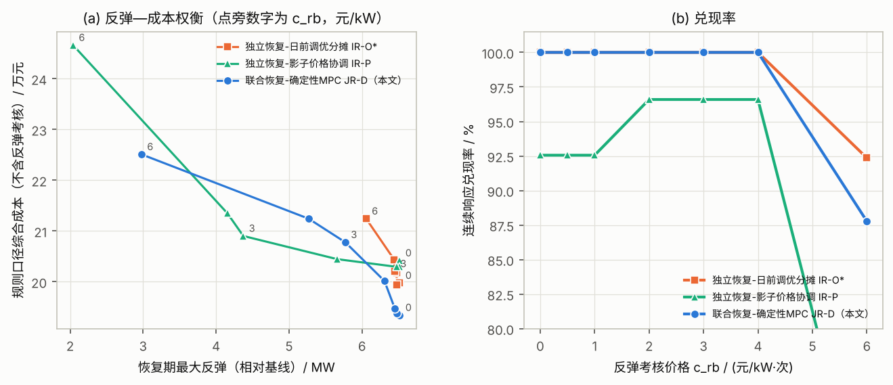

*图10 (a) 不含反弹考核的成本与最大反弹的权衡（点旁数字为 $c^{\rm rb}$，元/kW）；(b) 兑现率随反弹考核价格的变化。*

**补贴单价 × 短缺考核系数（实验 9）。**

- 9 种组合中 JR-D 的成本都最低，相对最强基准降低 1.5%（1 元/kWh、κ=0.5）至 4.0%（3 元/kWh、κ=2）。补贴越高、短缺考核越重，联合恢复越有价值。
- 补贴降到 1 元/kWh 时，三种优化策略都只部分响应（JR-D 兑现 33%–88%）：此时多数事件不值得保有效。

### 6.9 消融、机理贡献与收益来源（实验 7、图 16）

**消融（实验 7，统一 6 MW，$c^{\rm rb}$=3，完美信息）**

| 配置 | IR-O 兑现率 / 综合成本 | JR 兑现率 / 综合成本 | JR 相对 IR-O |
|---|---|---|---|
| 完整系统 | 89.2% / 25.58 万元 | 100% / 22.80 万元 | −10.9% |
| 去掉算力柔性（L=0） | 29.0% / 28.72 | 29.0% / 28.72（两者完全相同） | 0 |
| 去掉电储能 | 16.4% / 35.54 | 36.1% / 32.38 | −8.9% |
| 去掉蓄冷 | 68.1% / 27.03 | 100% / 23.49 | −13.1% |
| IR-O 事后最优静态分摊 α\*=0.9 | 100% / 24.49 | — | JR 低 6.9% |

- 去掉算力柔性后两种策略完全一致：只剩一类恢复状态时没有协调空间，收益来自“算”“储”两类状态的协调。
- 即使把独立策略的分摊比例调到事后最优（α\*=0.9，兑现率 100%），JR 的综合成本仍低 6.9%。

**机理贡献瀑布（图 16b，事件确定、$c^{\rm rb}$=3，52 个运行日的平均成本）。** 从规则独立恢复 IR-R（30.25 万元/日）出发，每一步加入一种协调机制：

| 加入的机制 | 成本变化 / 万元·日⁻¹ |
|---|---|
| 各侧分别优化（IR-O） | −4.25 |
| 日前回测调优分摊（IR-O\*） | −1.70 |
| 日前通道价格协调（IR-P） | −1.10 |
| 联合分配通道，但逐事件（JR-M） | **+1.61** |
| 跨事件远见（JR-D，本文） | −2.28 |
| 场景对冲（JR-S，E3 不确定时） | −0.08 |
| 合计 | −7.80（−25.8%） |

**贡献排序与解读：**

- 各侧优化贡献最大，其次是跨事件远见。
- 没有跨事件远见的联合分配（JR-M）反而比价格协调更差：它在当前事件后按“只剩下一个事件”的视角补算或回充，常把通道用在错误的状态上。这说明“联合”与“跨事件”缺一不可。
- 场景对冲的增量很小，与第 6.3 节一致。

**收益来源拆解（图 16a，JR-D 相对较强基准的日均节省）：**

| 设定（对比基准） | 合计 | 反弹考核 | 补贴 | 短缺考核 | 能量 | 任务延迟 | 期末折算 |
|---|---|---|---|---|---|---|---|
| 事件确定、$c^{\rm rb}$=3（IR-P） | 0.67 万元 | **0.52** | 0.08 | 0.09 | 0.09 | −0.08 | −0.03 |
| 事件确定、$c^{\rm rb}$=0（IR-O\*） | 0.61 万元 | 0 | **0.52** | 0.05 | −0.07 | 0.10 | 0.00 |
| E3 不确定（IR-P） | 0.94 万元 | 0.37 | 0.09 | 0.09 | −0.03 | **0.44** | −0.01 |

- **反弹定价口径：** 节省的 78% 来自反弹考核，即联合恢复把补算挪到通道不贵的时段。
- **规则口径：** 86% 来自多拿的补贴（三次事件都保住有效）。
- **E3 不确定：** 任务延迟成本的节省最大。IR-P 的 IT 侧按日前价格行事，在 E3 是否调用未知时推迟过多。
- **能量成本在各设定中几乎不变：** 联合恢复不是靠多做峰谷套利省钱。

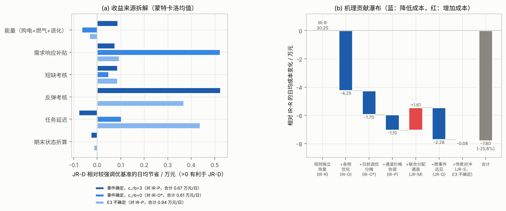

*图16 (a) JR-D 相对较强基准的日均节省按来源拆解；(b) 机理贡献瀑布。*

### 6.10 真实性、多能耦合与政策约束（实验 10、17）

**真实性（实验 10，统一 6 MW，$c^{\rm rb}$=3，确定性滚动）**

| 工况 | IR-O\* | IR-P | **JR-D** | JR-D 相对最强基准 |
|---|---|---|---|---|
| 基准 | 100% / 24.57 | 96.6% / 23.61 | **100% / 22.84** | −3.3% |
| 液冷（COP 15−0.25(T−25)，并网上限随之降为 14.59 MW） | 94.3% / 22.66 | 80.8% / 23.10 | **100% / 20.98** | −7.4% |
| IT 爬坡 ≤2 MW/15 min | 100% / 23.45 | 98.1% / 23.37 | **100% / 22.98** | −1.6% |
| IT 爬坡 ≤1 MW/15 min | 100% / 23.56 | 95.5% / 23.47 | **100% / 23.29** | −0.8% |
| 事件前抬升考核 1000 元/MWh | 100% / 25.31 | 96.6% / 24.36 | **100% / 23.59** | −3.2% |
| GPU 功率封顶（ρ=0.3，β=0.4） | 92.0% / 24.63 | 96.4% / 22.94 | **100% / 22.28** | −2.9% |

（表中为兑现率 / 综合成本，万元。）

1. **液冷使联合恢复更重要。** 液冷降低了制冷电耗，并网上限随典型日峰值下降，通道更窄。此时 IR-P 只兑现 80.8%，JR-D 仍全部兑现，成本低 7.4%。
2. **IT 爬坡限制压缩了联合恢复的空间。** 1 MW/15 min 时降幅只剩 0.8%：补算的时间分布被爬坡限制“摊平”，JR 能调整的余地变小。
3. **事件前抬升考核不改变调度。** 所有策略的成本都多出同样的考核额。抬升来自为事件保留储能，而不是操纵基线（第 3.4 节）。
4. **GPU 功率封顶是有效的附加手段。** 封顶每降 1 单位功率只留下 0.4 单位欠账，JR-D 的成本因此再降 2.4%，最大反弹从 5.77 MW 降到 4.02 MW。

**多能耦合与政策约束（实验 17，$c^{\rm rb}$=3，完美信息，C=6 MW 除另注；图 21）**

1. **机房热惯性（第三类恢复状态）。**
   - 允许机房在设定值上下浮动（+3/−2 K）后，三种策略都把热惯性用满（最高升温 3.0 K），日均成本都降 0.86–0.88 万元（JR：22.80 → 21.94）。闭环 26 个运行日也是如此：JR-D 降 3.8%，IR-P 降 4.3%。
   - 热惯性相当于又一块“免费的快速储能”，设施 EMS 在独立恢复中也能用。承诺 8 MW 时，IR-P 的兑现率由 92.9% 升到 99.4%，与 JR（99.5%）持平。
   - 联合恢复的成本优势仍在，但缩小：完美信息 8 MW 时 −2.6%，闭环 −2.2%（p=1.5×10⁻⁷）。
   - 热惯性让“储”这一侧更宽裕，从而部分替代了联合恢复的作用，这与 6.4 节电池越大优势越小一致。
2. **绿电占比。** 60%/80%/90% 的目标使所有策略的日成本增加 0.68/0.95/1.08 万元，策略间相差不到 10 元。在本文口径下，绿电约束等价于对购电与燃气发电统一加价，不改变各策略的相对优劣。
3. **PUE 上限。**
   - 不设上限时 DR 日 PUE 为 1.262–1.264。上限 1.25 时三种策略都能达标，成本增加 0.24（JR）–0.31（IR-O\*）万元。
   - 上限 1.20 不可行：当日最低可达 1.246，成本增加 0.48–0.55 万元。
   - 达标的手段是更多用余热吸收式制冷、夜间蓄冷，并把补算挪到气温较低的时段。联合恢复达标的代价最低。
4. **联络线爬坡约束。**
   - 若电网要求购电每 15 min 变化不超过 4/2/1 MW，“事件开始时快速降负荷”本身就受限。JR 的兑现率降到 82.9%/54.6%/40.2%，独立基准降得更多（IR-P：64.9%/41.2%/27.2%）。JR 相对 IR-P 的成本低 4.0%/6.7%/2.8%。
   - 不加约束时 JR 的最大单步变化为下降 8.8 MW、上升 12.4 MW。江苏细则按事件小时平均削减判定有效性，并不要求如此快的爬坡。若引入爬坡要求，需要把承诺与有效性判定一并调整。

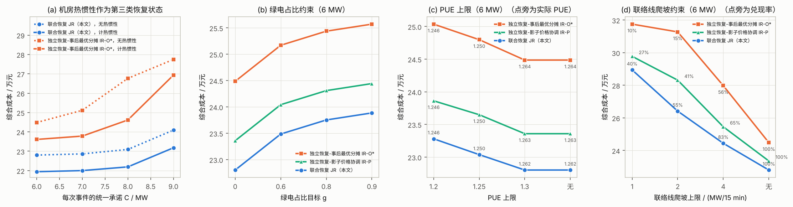

*图21 (a) 机房热惯性开/关时综合成本随承诺的变化；(b) 绿电占比目标；(c) PUE 上限（点旁为实际 PUE）；(d) 联络线爬坡上限（点旁为兑现率）。*


### 6.11 泛化：电价形态、季节与气候（实验 16、18）

**分时电价形态（实验 16，日均电价相同）**

| 电价形态 | 蒙特卡洛均值 IR-O\* / IR-P / JR-D（万元/日） | JR-D 相对 IR-P（逐日配对） | 8 MW 完美信息兑现率 IR-O\* / IR-P / JR |
|---|---|---|---|
| 江苏分时（基准） | 24.21 / 23.09 / 22.43 | −2.86%，p=4×10⁻⁶ | 74.5% / 92.9% / 99.5% |
| 平电价 | 27.94 / 27.08 / 26.51 | −2.11%，p=4×10⁻⁶ | 74.5% / 93.0% / 99.5% |
| 两段峰谷（峰 8–22 h） | 24.94 / 24.03 / 23.40 | −2.61%，p=2×10⁻⁶ | 75.5% / 93.0% / 99.5% |
| 含尖峰（19–21 h） | 24.13 / 22.96 / 22.30 | −2.85%，p=4×10⁻⁶ | 76.4% / 92.9% / 99.5% |
| 鸭子曲线（谷 10–15 h，峰 17–23 h） | 25.20 / 24.22 / 23.53 | −2.84%，p=2×10⁻⁶ | 69.3% / 92.9% / 99.5% |

（蒙特卡洛为 20 个运行日、统一 6 MW。）

- 联合恢复的优势与电价形态基本无关：成本降幅 2.1%–2.9%，8 MW 时的兑现率始终 99.5%。
- 平电价下优势最小：没有分时价差时，补算与回充挪到哪个时段的差别变小。

**季节与气候（实验 18，同一组算力轨迹、江苏规则与电价）**

| 工况 | 并网上限 / MW | 日均 COP | 光伏 / (MWh/日) | 可靠可交付容量 IR-O\* / IR-P / JR（MW） | 闭环全有效 IR-O\* / IR-P / JR-D | JR-D 相对 IR-P |
|---|---|---|---|---|---|---|
| 苏州夏季（基准，最高 38.3 °C） | 16.03 | 5.13 | 38.9 | 6 / 6 / **8** | 90% / 95% / **100%** | −2.86% |
| 苏州冬季（最低 −3.0 °C） | 15.51 | 7.00 | 26.0 | 6 / 7 / **7** | 95% / 95% / **100%** | −2.61% |
| 贵安夏季（国家枢纽，最高 31.7 °C） | 15.67 | 5.77 | 44.9 | 6 / 6 / **7** | 95% / 95% / **100%** | −2.80% |

（可靠可交付容量为完美信息下 ≥99% 兑现且三次全有效的最大统一承诺；闭环为 20 个运行日、统一 6 MW，逐日配对 p 均为 4×10⁻⁶。）

- 三种气候下，JR-D 都每天全部有效，成本都低约 2.6%–2.9%（图 20）。
- 冬季与凉爽气候中，冷负荷小、COP 高，与制冷相关的可调电量减少，JR 的可靠容量降为 7 MW。冬季 IR-P 也能达到 7 MW。
- 联合恢复的价值随“恢复通道是否紧张”而变化，这与定理 1 一致：炎热夏季的晚高峰最需要它。
- 驱动因素的相关性（图 17）说明了晚高峰为何紧张：常态运行中储能在峰价时段放电，压低了 17–22 h 的基线；此时光伏已退出，削减只能更多依靠算力推迟与储能额外放电。

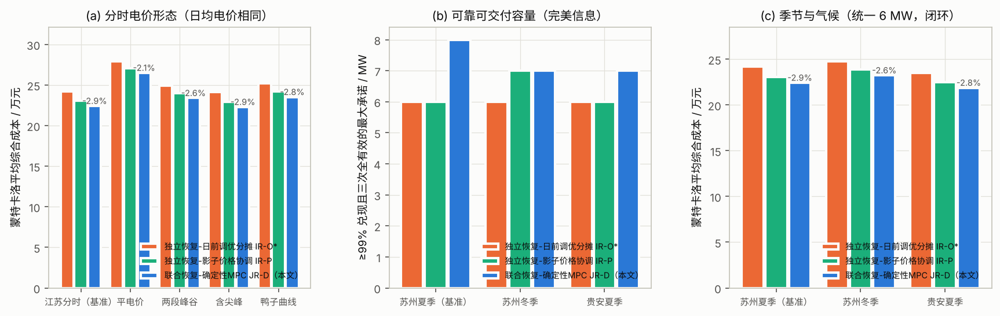

*图20 (a) 分时电价形态；(b) 各气候的可靠可交付容量；(c) 各气候的闭环平均成本（标注为 JR-D 相对较强基准的降幅）。*

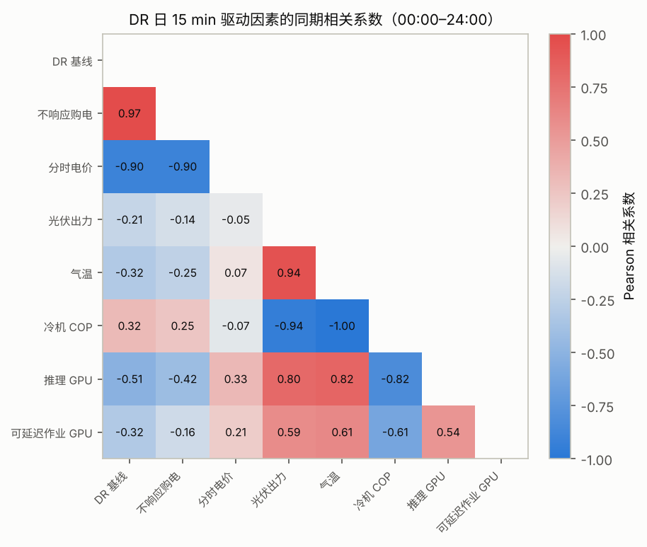

*图17 DR 日 15 min 驱动因素的同期相关系数。推理负载与气温、光伏同为午后高峰（r≈0.8）。DR 基线与分时电价高度负相关（r=−0.90）：常态运行中储能在峰价时段放电，使事件所在的 17–22 h 基线降到约 9.6 MW。此时光伏已退出、电价仍为峰价，削减只能更多依靠算力推迟与储能额外放电，事后的恢复需求也因此更大。*

### 6.12 计算效率（实验 14）

单线程 GNU Octave 8.4 + glpk，在空闲机器上计时（中位数）。

| 模型 | 时域 H / 步 | 场景 S | 事件 K | 变量 | 0–1 变量 | 约束 | 求解时间 / s |
|---|---|---|---|---|---|---|---|
| 日内 MPC | 24 | 1 | 3 | 520 | 3 | 392 | 0.007 |
| 日内 MPC（JR-D） | 72 | 1 | 3 | 1 193 | 3 | 880 | 0.029 |
| 日内 MPC | 72 | 5 | 3 | 5 965 | 15 | 4 444 | 0.48 |
| 日内 MPC | 72 | 10 | 3 | 11 930 | 30 | 8 899 | 1.91 |
| 日内 MPC | 72 | 5 | 2 / 4 | 5 940 / 5 990 | 10 / 20 | 4 384 / 4 504 | 0.46 / 0.49 |
| 日前耦合承诺 | 120 | 5 | 2 / 3 / 4 | — | — | — | 2.25 / 2.87 / 4.32 |
| 日前分布鲁棒承诺（实验 15） | 120 | 10 | 3 | — | 30 | — | 14–25 |

- 每 15 min 求解一次 MPC，最耗时的 10 场景模型也不到 2 s，远小于控制周期。确定性 MPC 滚动一整天（120 步）约 4 s。
- 规模随场景数线性增长，0–1 变量数为“事件 × 场景”。
- 与 Zhang 等（2026）需要 C&CG 迭代 8 次、850 s 的 MISOCP 相比，本文的分布鲁棒重构是一次求解的 MILP。

### 6.13 作业级验证：流体模型何时可信（实验 19、20，审稿意见 6f）

前 12 节的结果都来自“流体”模型：积压可以在任意空闲 GPU 上以任意并行度补算。为检验这一点，每次闭环运行都交给作业级执行器重放并重新结算（5.4 节）。作业从轨迹抽取，整组运行、不能加速；开销取基准值（检查点 1 min、重启 5 min、最短暂停 15 min）。

**案例日（图 22a、b，PAI 负荷）。**

- 流体模型下，JR-D 在每个事件之后都安排了大规模补算（E1 后约 +3 MW、E3 后约 +3–5 MW 的 IT 功率），主要是长作业的积压。刚性作业做不到这一点：计划中 11 543 GPU·h 的补算无法执行，作业的滞后在 E3 前就已用尽，只能被迫运行。结果 E3 的平均削减只有 3.7 MW（低于 4.8 MW 的有效线），E3 无效，综合成本由 22.84 万元升到 30.98 万元（+36%）。其余五种策略在作业级执行时也都至少丢掉一个事件。
- 加入刚性补算约束（3.1 节）后，JR-D 的计划变为：E1 主要暂停中作业，E2 暂停中、长作业，E3 把长作业全部暂停，长作业积压（约 3 900 GPU·h）带到次日按名义结束时刻补回。计划成本为 25.15 万元，比流体计划高 10%，因为不能再依赖间隔内补算。作业级执行为 26.52 万元（+5.4%，主要是暂停/重启开销），三次事件全部有效，购电功率跟踪误差 0.22 MW，未能执行的补算降到 397 GPU·h。

**52 个运行日（图 22c、d）。**

| 负荷 · 计划所用恢复模型 | 作业级三次全有效的天数：JR-D / 最强独立基准 | 作业级成本：JR-D 相对最强独立基准 | JR-D 作业级 / 流体评价成本 |
|---|---|---|---|
| PAI · 流体 | 5.8% / 0%（IR-O\*、IR-P） | −4.7%（对 IR-P，52/52 天，p=3.5×10⁻¹⁰） | +34.9% |
| PAI · 刚性 | 86.5% / 46%–60%（IR-O\*、IR-P） | −3.0%（对 IR-P，50/52 天，p=1.0×10⁻⁹） | +6.9% |
| Acme · 流体 | 65% / 33%–35% | −7.8%（对 IR-P，50/52 天，p=5.3×10⁻¹⁰） | +30.7% |
| Acme · 刚性 | 98% / 75%–87% | −5.0%（对 IR-O\*，51/52 天，p=3.9×10⁻¹⁰） | — |

1. **流体模型对刚性长作业过于乐观。** 按它做的计划在作业级执行时，PAI 负荷下几乎每天都有事件失效（任何策略三次全有效的天数都不超过 8%），成本被低估 11%–38%。Acme 负荷长作业占 80%，同样只有 33%–71% 的天数全部有效。
2. **刚性补算约束让计划可以执行。** JR-D 三次全有效的天数，Acme 负荷下为 98%，PAI 负荷下由 5.8% 提高到 86.5%，跟踪误差约 0.2–0.3 MW。同一策略按刚性模型做计划，作业级成本比按流体模型低 12%–16%（JR-D：Acme 22.13 对 25.12 万元/日，PAI 26.13 对 30.39 万元/日）。
3. **联合恢复的优势在作业级保持。** 流体模型计划下扩大到 4.7%–7.8%；刚性模型计划下为 5.0%（Acme）与 3.0%（PAI），不低于流体评价下的 2.9%–3.1%。流体模型计划下优势扩大的原因见[`理论推导.md`](理论推导.md) 第 1 节末：刚性作业使间隔内补算受限，通道更多只能用于储能回充（效率 η）。独立恢复依赖间隔内补算来腾出算力虚拟储能，受影响更大；联合恢复把长作业积压携带过最后一个事件，不必在间隔内补算。
4. **记账方式。** 在刚性约束下，流体模型按到达批次记截止期，名义负荷下降时会报告并不存在的逾期：结束的延迟作业的“尾巴”本应提供补算，一阶约束 $B/\tau_c$ 不含这部分。Acme 刚性变体的平均流体逾期为 46–638 GPU·h·h，而作业级执行中逾期恒为 0。因此刚性变体以作业级结果为准。

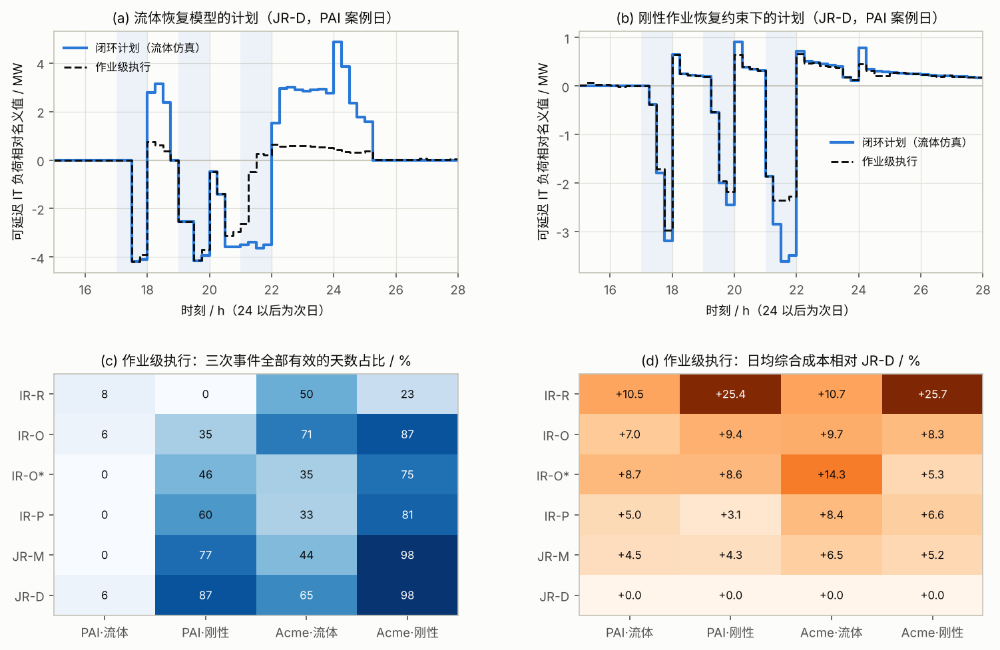

*图22 作业级验证。(a)(b) PAI 案例日 JR-D 的闭环计划与作业级执行（可延迟 IT 负荷相对名义值）：(a) 流体恢复模型，(b) 刚性补算约束；(c)(d) 52 个运行日作业级执行的三次全有效天数占比与日均综合成本（相对 JR-D）。*

**大模型时代负荷（Acme）本身。** Acme 负荷几乎没有日周期，长作业占 80%。流体模型下 JR-D 相对 IR-P 的成本仍降低 3.1%（52/52 天，p=3.5×10⁻¹⁰），与 PAI 负荷的 2.9% 相当，三次全有效的天数为 100% 对 98%。

**作业组合与开销（实验 20，图 23）。** 案例日上把作业来源换成 Seren、Kalos（512–1 024 卡的预训练作业）或把作业卡数放大 2–4 倍，并改变暂停开销：

- **刚性模型的计划在所有设定下都可执行。** 在全部 14 个“负荷 × 作业设定”组合中，JR-D 三次事件都有效，其中 13 个组合成本最低；唯一例外是 Acme 负荷的慢检查点/重启，IR-O\* 低 0.15%（同样三次有效）。PAI 负荷下，作业级成本比流体评价高 1.4%（无开销）、5.5%（基准开销）至 13%（慢检查点/重启）。
- **最强独立基准对开销更敏感。** PAI 负荷下，慢检查点/重启使 IR-O\* 只剩 1 个有效事件，仅周期检查点时剩 2 个；IR-P 在所有设定下至少丢一个事件（Kalos 作业时丢两个）。基准开销下，JR-D 相对 IR-O\* 的作业级成本低 4.9%（PAI）与 2.7%（Acme）。
- **开销的量级。** 基准开销下，一天约有 650–4 100 次暂停（小作业多，次数就多），重启耗时约 1 100–1 400 GPU·h，检查点损失约 220–300 GPU·h，合计约 1.3–1.6 MWh 电量，使 JR-D 的日成本增加 2%–4%。慢检查点/重启时开销约为基准的 3 倍。
- **整组粒度影响不大。** 即使最大被暂停作业达 0.7–1.2 MW（Kalos 或卡数放大），JR-D 的成本也只变化 0.3%–1.4%：执行器用小作业回填，类内的粒度误差可由其他类吸收。
- **功率阶跃。** 事件开始时所有暂停在同一分钟完成，可延迟 IT 功率的 1 min 阶跃约 3–4 MW。若电网对爬坡有要求，可在几分钟内错开完成，或用实验 10 的 IT 爬坡约束直接纳入调度。

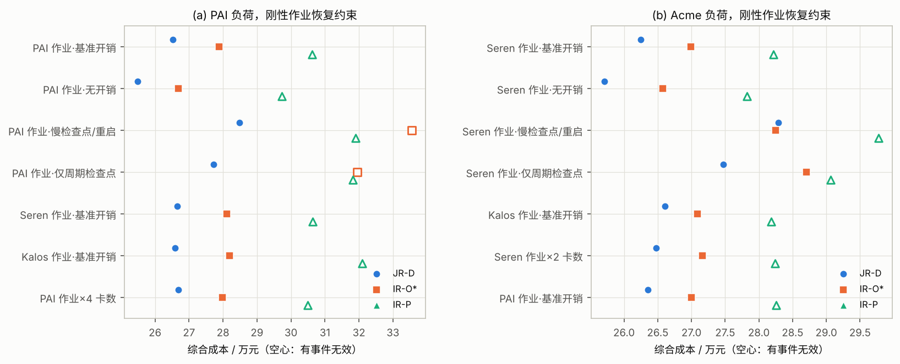

*图23 案例日作业级综合成本随作业组合与暂停开销的变化（刚性补算约束；空心标记表示有事件无效）。*

### 6.14 绿电直连：表后海上风电（实验 21，图 26）

设置见 3.2 节与 5.3 节：如东海上风电表后接入、不上网；并网容量保持无风电时的 16.0 MW；风电日前预测误差的均方根为装机的 15%；每个运行日按当日预测重新求解日前承诺与 IR-P 价格，IR-O\* 的分摊比例在案例日调优。

**绿电直连曲线（无需求响应运行，案例日 + 52 个运行日）。**

| 风电装机 / MW | 0 | 5 | 10 | 15 | 20 | 25 | 30 | 40 |
|---|---|---|---|---|---|---|---|---|
| 可再生占用电量比例（均值） | 11.0% | 25.6% | 40.0% | 51.8% | 58.4% | 63.1% | 66.6% | 71.9% |
| 其中 ≥30% 的天数 | 0 | 25% | 72% | 89% | 94% | 96% | 96% | 98% |
| 自发自用占可用发电量（均值） | 100% | 100% | 100% | 97.0% | 89.1% | 81.8% | 75.5% | 65.5% |
| 其中 ≥60% 的天数 | 100% | 100% | 100% | 100% | 100% | 91% | 83% | 59% |
| 两项同时满足的天数 | 0 | 25% | 72% | 89% | 94% | 87% | 79% | 57% |
| 购电费用 / 万元·日⁻¹ | 19.2 | 15.5 | 12.0 | 9.8 | 8.4 | 7.5 | 6.8 | 5.9 |

650 号文按年度考核这两项比例。按均值，风电约 7 MW 以上即满足“占用电量 ≥30%”，到 40 MW 仍满足“自用 ≥60%”。按日看，两项同时满足的日子在 20 MW 时最多（94%；按 2030 年的 35% 门槛为 91%），15 MW 与 25 MW 时为 87%–89%。对该数据中心，约 1.25 倍并网容量（20 MW）的风电与 650 号文最匹配。

**需求响应（26 个运行日）。**

| 风电 / MW | 日均风电 / MWh | 日前承诺合计 / MW（申报事件占比） | JR-D 需求响应收入 / 万元·日⁻¹ | JR-D 日均成本 / 万元 | JR-D 相对 IR-P | 三次全有效：JR-D / IR-P / IR-O\* |
|---|---|---|---|---|---|---|
| 0 | 0 | 17.7（100%） | 6.21 | 22.46 | −2.5%（25/26 天，p=9×10⁻⁸） | 100% / 96% / 96% |
| 5 | 50 | 13.4（96%） | 4.41 | 18.99 | −6.6%（24/26 天，p=1×10⁻⁶） | 92% / 58% / 92% |
| 10 | 100 | 7.8（92%） | 2.36 | 16.21 | −6.6%（24/26 天，p=3×10⁻⁶） | 77% / 46% / 58% |
| 20 | 199 | 6.6（100%） | 2.08 | 10.77 | −5.9%（21/26 天，p=0.002） | 85% / 73% / 65% |

1. **关口表基线让可交付承诺随风电装机迅速下降。** 基线取参考日的关口表数据，继承了参考日的风电；运行日的风电一旦偏离参考日的平均水平，即使负荷不变，电表上的“削减量”也随之偏离。日前承诺合计由 17.7 MW 降到 20 MW 风电时的 6.6 MW（−63%），JR-D 的需求响应收入降到三分之一。预测风电偏少的日子，日前模型干脆不申报部分事件（10 MW 时 8% 的事件申报为 0）。
2. **风电省下的电费远多于损失的需求响应收入。** JR-D 的日均成本由 22.5 万降到 10.8 万元（20 MW）。
3. **联合恢复的优势在风电下扩大。** 相对 IR-P 降低 5.9%–6.6%（无风电时 2.5%）。风电预测误差使事件期间的净负荷偏离计划，所有策略的有效率都下降，独立恢复下降更多：三次全有效的天数，IR-P 为 46%–73%，JR-D 为 77%–92%。联合恢复跨事件统筹算力积压与储能，留给纠偏的余量更大。
4. **策略差异来自风小、预测有误差的日子。** 风大的案例日（10 MW 时 122 MWh，20 MW 时 244 MWh）承诺小、容易兑现，各策略成本相差不到 1%。
5. **政策含义。** 按关口表核定基线，会把表后风电的波动计为“响应”或“反响应”（基线取法的一般讨论见 [32]）。绿电直连项目若单独计量发电、按扣除风电后的用户负荷核定基线，可以保留数据中心的调节能力；这需要在政策层面明确。

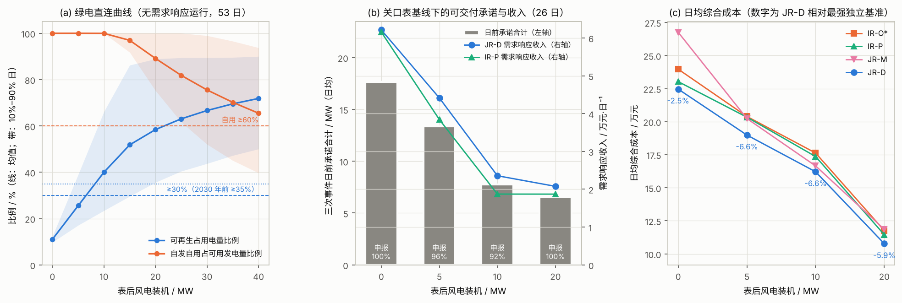

*图26 绿电直连海上风电。(a) 无需求响应运行的可再生占用电量比例与自发自用率（线为均值，带为 10%–90% 日），虚线为 650 号文门槛；(b) 日前承诺合计（柱，柱内为申报事件占比）与需求响应收入；(c) 日均综合成本，数字为 JR-D 相对最强独立基准的成本差。*

### 6.15 暂停/恢复开销与多档功率封顶（实验 22，图 25a）

流体模型加入两项可选扩展（3.1 节）：

- **暂停/恢复开销。** 相对名义负荷每新暂停一张 GPU（$u_{c,t}$），就增加 $o_c$ GPU·h 的额外工作（检查点 + 重启）。基准开销 $o_c$=(1+5)/60 h（异步检查点 1 min + 重启 5 min），慢速 (10+15)/60 h（大模型同步检查点 + 慢重启）。
- **多档功率封顶。** 单档为功率 −30%、吞吐 −12%；三档为功率 −15%/−30%/−45%，对应吞吐 −3%/−12%/−30%，按凸分段线性的透视函数精确线性化。

承诺统一取 6 MW，每种设定重新调优独立基准，26 个运行日。

| 设定 | JR-D 日均成本 / 万元 | JR-D 相对 IR-P | 三次全有效的天数：JR-D / IR-P / IR-O\* | 暂停开销 GPU·h：JR-D / IR-P / IR-O\* |
|---|---|---|---|---|
| 基准（流体） | 22.50 | −2.8%（25/26 天） | 100% / 96% / 92% | — |
| 暂停开销 6 min | 23.20 | −2.6%（25/26 天） | 96% / 88% / 62% | 1 465 / 1 761 / 2 919 |
| 暂停开销 25 min | 24.10 | −2.3%（24/26 天） | 100% / 81% / 27% | 3 869 / 4 686 / 5 624 |
| 单档封顶 | 21.87 | −4.8%（26/26 天） | 100% / 62% / 65% | — |
| 三档封顶 | 21.83 | −4.5%（26/26 天） | 100% / 65% / 65% | — |
| 三档封顶 + 暂停开销 6 min | 22.55 | −2.6%（22/26 天） | 96% / 58% / 38% | 1 169 / 1 111 / 244 |

（配对 Wilcoxon 检验 p 均 <4×10⁻⁴。）

1. **暂停开销使成本上升 3.1%（6 min）与 7.1%（25 min）**，与作业级仿真（实验 20：2%–4%）同一量级。JR-D 仍最便宜，相对 IR-P 的降幅从 2.8% 收窄到 2.3%。独立基准的可靠性下降更快：IR-O\* 三次全有效的天数由 92% 降到 62% 与 27%。开销按“新暂停的卡数”计，IR-O\* 的静态分摊在事件之间反复暂停、恢复，开销最大；JR-D 把长作业连续推迟，开销最小（6 min 时为 IR-O\* 的一半）。
2. **封顶让各策略都更便宜，也扩大了联合恢复的优势。** JR-D 的成本下降 2.8%，相对 IR-P 的降幅扩大到 4.5%–4.8%（26/26 天）。封顶的代价是吞吐损失，它变成额外积压；IR-P 三次全有效的天数由 96% 降到 62%–65%，JR-D 仍为 100%。这与“联合恢复把封顶留下的积压与储能缺口一起跨事件安排”一致。
3. **三档封顶只比单档再便宜 0.2%。** 单档（−30% 功率 / −12% 吞吐）已基本够用，多档曲线的收益有限。
4. **封顶与开销同时存在时，两者大体抵消。** JR-D 为 22.55 万元，与基准相当，相对 IR-P 仍低 2.6%（22/26 天）。此时 IR-O\* 更多用封顶而少暂停，开销只有 244 GPU·h，但三次全有效的天数仅 38%。

### 6.16 日前场景：K-means 缩减与季节漂移（实验 23，图 25b–d）

日前承诺原本用 5 个等概率场景：按算力负荷与光伏的日水平取分位数。这里改用 K-means：把算力日与气象日的全部 280 种组合聚类，取中心日作场景、簇大小作概率（K=5、10、20），并在其周围构造 δ=0.4 的 ℓ1 分布鲁棒集（命题 3）。每组承诺都交给 JR-D 在 52 个样本外运行日滚动执行。

| 场景设定 | 承诺 E1/E2/E3（MW） | 样本内期望 / 万元 | 样本外均值 / 万元 | 相对分位-5（配对） | 样本内低估 |
|---|---|---|---|---|---|
| 分位-5 | 3.27 / 6.65 / 7.90 | 19.92 | 22.50 | — | 13.0% |
| K-means-5 | 2.42 / 5.63 / 7.90 | 20.96 | 22.45 | −0.19% | 7.1% |
| K-means-10 | 3.69 / 4.72 / 7.90 | 20.68 | 22.46 | −0.15% | 8.6% |
| K-means-20 | 3.73 / 5.51 / 7.90 | 20.22 | 22.48 | −0.07% | 11.2% |
| K-means-5 + DRO | 0.92 / 6.32 / 7.90 | 21.10 | 22.45 | −0.23% | 6.4% |
| K-means-10 + DRO | 4.71 / 2.99 / 7.90 | 20.86 | 22.46 | −0.19% | 7.6% |

1. **样本外成本对场景生成几乎不敏感。** 六种设定的样本外均值相差不到 0.23%，52 天每天三次事件全部有效。承诺本身差别很大（E1 为 0.9–4.7 MW，E2 为 3.0–6.7 MW），说明成本在最优承诺附近很平坦，与 6.5 节一致。K-means 的改进在统计上显著（配对 Wilcoxon p≤3×10⁻⁵），但量级可以忽略。
2. **样本内估计普遍偏乐观 6%–13%。** 偏差主要来自每个场景内的完美信息：日前模型在每个场景里按已知负荷与气象优化，实际运行只有预测。K-means-5/10 与分布鲁棒把偏差降到 6%–9%，20 个场景时又回升到 11%，没有单调规律。因此用日前模型估计报价收益或做投资评估时，应以滚动执行的样本外成本为准。
3. **季节漂移影响很小。** 冬季案例日（2025-01-10）的算力池不变，气象池（光伏与冷机 COP）分别取冬季与夏季：

   | 冬季日的场景来源 | 承诺 E1/E2/E3（MW） | 26 个冬季样本外日的成本差（相对冬季池随机规划） |
   |---|---|---|
   | 冬季池，随机规划 | 4.18 / 6.10 / 7.51 | — |
   | 夏季池，随机规划 | 5.61 / 3.73 / 7.51 | −0.12% |
   | 夏季池，DRO δ=0.4 | 5.17 / 2.25 / 7.51 | −0.30% |
   | 夏季池，DRO δ=1.2 | 0 / 5.63 / 7.51 | −0.34% |
   | 冬季池，DRO δ=0.4 | 1.87 / 5.81 / 7.51 | −0.34% |

   用错季节的场景时承诺明显改变，但样本外成本不升反降 0.12%，每天全部有效；分布鲁棒集再稳定地降低约 0.3%。可见在本算例中，气象场景对承诺的样本外价值影响很小；分布鲁棒承诺在季节漂移下仍提供小幅、稳定的对冲。

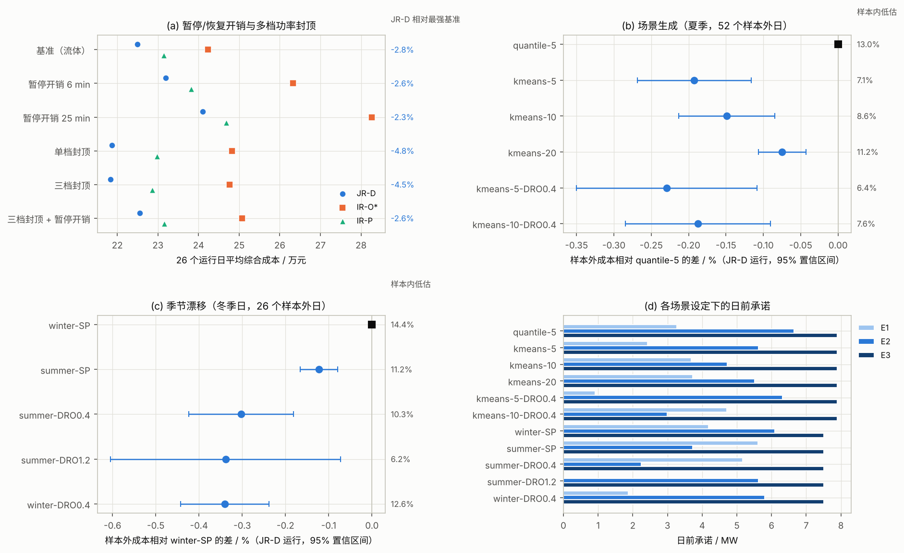

*图25 (a) 暂停/恢复开销与多档功率封顶下 26 个运行日的平均综合成本（右侧为 JR-D 相对最强独立基准的成本差）；(b)(c) 日前场景生成与季节漂移：样本外成本相对参照设定的配对差（95% 置信区间，右侧为样本内估计相对样本外的低估）；(d) 各设定的日前承诺。*

### 6.17 冬季余热回收供热（实验 24，图 27）

设置见 3.2 节：冬季寒潮日 2025-01-10（日均 0.4 °C）为案例日，26 个最冷的冬季日为运行日。附近供热管网的热需求为 $0.3\max(18-T_t,0)$ MW$_{\rm th}$，案例日约 5.3 MW$_{\rm th}$，全天 127 MWh$_{\rm th}$。热泵 3 MW$_{\rm el}$、COP 3.5；并网容量固定在无供热时的 15.5 MW；承诺统一取 6 MW，每种设定重新调优独立基准。

| 设定 | JR-D 日均成本 / 万元 | JR-D 相对 IR-P | 三次全有效：JR-D / IR-P / IR-O\* | 余热占供热比例：JR-D / IR-P | 锅炉补热 / MWh：JR-D / IR-P |
|---|---|---|---|---|---|
| 燃气锅炉供热 | 28.25 | −2.1%（25/26 天） | 100% / 96% / 96% | 0 / 0 | 138.6 / 138.6 |
| 热泵，无蓄热 | 23.56 | −4.4%（26/26 天） | 100% / 69% / 96% | 82.6% / 77.4% | 24.1 / 31.3 |
| 热泵 + 20 MWh 蓄热 | 23.56 | −2.3%（25/26 天） | 100% / 96% / 96% | 97.1% / 91.4% | 4.1 / 12.1 |
| 热泵 + 40 MWh 蓄热 | 23.88 | −1.4%（25/26 天） | 100% / 96% / 92% | 99.9% / 99.4% | 0.2 / 0.8 |

（锅炉补热含次日 6 h；配对 Wilcoxon 检验 p 均 <10⁻⁵。）

1. **余热回收本身很划算。** 与燃气锅炉供热相比，日均成本低 15.5%–16.6%（JR-D 每天省 4.4–4.7 万元），碳排放每天少 16–19 t。
2. **没有蓄热时，热泵与补算争用事后通道。** 热泵负荷计入了基线，事件中关停即算作削减；但热需求不停，事后热泵要补足供热，正好与补算、电池回充争用并网余量。独立恢复的算侧先用掉了这部分余量：IR-P 三次全有效的天数由 96% 降到 69%，锅炉补热也更多。联合恢复把热泵一起统筹，优势扩大到 4.4%（26/26 天）。
3. **蓄热罐把供热与事件解耦。** 事件中关停热泵、由罐供热，事后再补热。各策略都恢复到 96%–100% 有效，联合恢复的优势回到 2.3%，但多回收约 6 个百分点的余热（锅炉补热 4.1 对 12.1 MWh）。事后的并网余量，联合恢复先给热泵，独立恢复先给补算：图 27c 中 E3 一结束 JR-D 就开启热泵，IR-P 推迟约 1.5 h，这段时间由锅炉供热。
4. **蓄热罐并非越大越好。** 40 MWh 罐在正常运行中已把峰段的热泵负荷全部移到谷时，案例日事件时段的基线比无罐时低约 0.7 MW、比 20 MWh 罐低约 0.3 MW（与 6.4 节“电池越大基线越低”同一机理）。JR-D 的成本因此比 20 MWh 罐高 1.4%，相对 IR-P 的优势降到 1.4%。

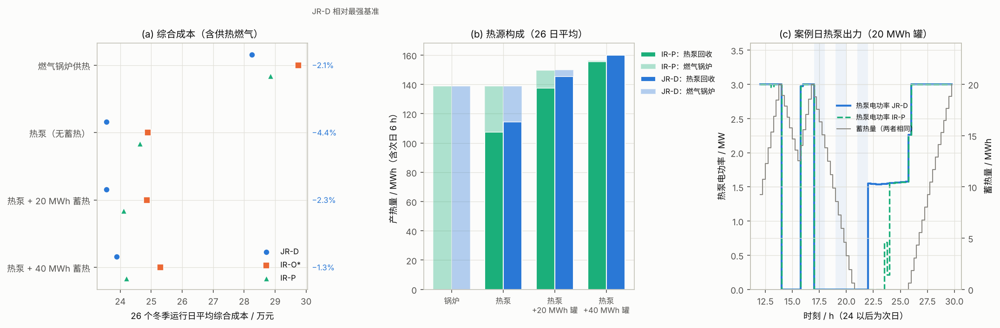

*图27 冬季余热回收供热。(a) 26 个最冷运行日的平均综合成本（含供热燃气；右侧为 JR-D 相对最强独立基准的成本差）；(b) 热泵回收与燃气锅炉的产热量（带蓄热罐时高于热需求的部分是时域末罐内补充的热）；(c) 案例日 20 MWh 罐时的热泵电功率与蓄热量。*

### 6.18 跨事件可交付能力域：从单个承诺值到承诺向量集合（实验 25，图 28）

前面各节都在给定承诺下比较策略。日前申报时，数据中心需要知道的是：三次事件的哪些承诺向量 $(C_1,C_2,C_3)$ 能够足额交付。命题 4 把这个集合定义为可交付能力域 $\mathcal C$。实验 25 在完美信息下沿 91 条射线 $C=t\,d$（$d$ 取单纯形上的网格）求出 $\mathcal C$ 与各独立基准的可交付域，并计算多事件能量界与顶点证书。取两种工况：基准（间隔 1 h，并网裕度 γ=1.10）与收紧（间隔 0.5 h，γ=1.00）。IR-O\* 对每条射线取事后最优的分摊比例，是静态分摊所能达到的上限。

| | 基准（τ=1 h，γ=1.10） | 收紧（τ=0.5 h，γ=1.00） |
|---|---|---|
| 单事件能力 $G_1/G_2/G_3$ / MW | 8.18 / 7.98 / 7.90 | 8.18 / 8.05 / 8.06 |
| JR 最大承诺总量 $h_{123}$（单事件能力之和） / MW | 24.06（24.06） | 19.43（24.29） |
| 多事件能量界 $\bar b$ = 虚拟储能 + 储能 + 通道 + 基线差 / MWh | 25.66 = 11.36 + 11.41 + 9.07 − 6.17 | 19.57 = 11.58 + 11.40 + 2.93 − 6.34 |
| 证书多面体 $\mathcal T$ | 精确（8 个顶点全部可交付） | θ\* = 0.9997（10 个顶点） |
| 统一承诺能力 / MW：JR / IR-P+ / IR-O\* / IR-O / IR-P | 7.90 / 7.90 / 6.44 / 5.50 / 4.52 | 6.48 / 6.47 / 6.44 / 3.05 / 2.55 |
| 可交付域体积相对 JR：IR-P+ / IR-O\* / IR-O / IR-P | 1.000 / 0.966 / 0.770 / 0.279 | 0.850 / 0.962 / 0.278 / 0.119 |

1. **联合恢复的能力域是“单事件能力盒 ∩ 一个总量切面”。**
   - 两种工况中，两两事件的支撑值都等于两者单事件能力之和，即任意两次事件之间从不冲突；只有三次事件总量的支撑值 $h_{123}$ 可能小于单事件能力之和，给出唯一的耦合切面 $C_1+C_2+C_3\le h_{123}$（各事件 1 h，即三次承诺电量之和）。
   - 基准工况中 $h_{123}$ 等于三次单事件能力之和，能力域就是单事件能力盒，三次事件互不影响。收紧工况中切面切掉盒的一角。
   - 这正是命题 4 的虚拟电池：各事件放电功率上限 $G_k$，跨事件能量预算 $h_{123}$。基准工况中证书多面体 $\mathcal T$ 的 8 个顶点全部可交付，描述是精确的；收紧工况中有一个顶点差一点（θ\*=0.9997），描述与真实能力域相差不到 0.03%。
2. **多事件能量界很紧。** 能量界在全部 24 个扫描工况与 52 个运行日都成立。在切面起作用的 14 个扫描工况与 18 个运行日中，界比 LP 精确值高 0.02–0.71 MWh（≤3.0%）。
   - 案例日晚高峰的不响应负荷比基线高约 2.2 MW。间隔不超过 1 h 时，三次事件的基线差 $\Delta$ 为 −6.2 至 −6.7 MWh，是能量预算中不可忽略的一项。命题 1 依赖的假设 H1 在这里不成立，命题 4 的界把它显式计入。
3. **独立恢复收缩的是跨事件能量预算，不是单事件能力。**
   - 基准工况中，IR-O\* 在全部单事件、两事件方向上都能达到 JR 的边界，损失集中在三次都高的角上：沿同一组射线的最大承诺总量 19.33 对 23.70 MW（−18.4%），统一承诺能力 6.44 对 7.90 MW（−18.4%），体积只少 3.4%。
   - 固定分摊 IR-O 的损失更大：体积少 23%，统一承诺能力只有 5.50 MW。
   - 收紧工况中通道本来就窄，IR-O\* 与 JR 几乎相同（定理 1 推论 1(c)），但在只给两次事件承诺的方向上（另一事件承诺为 0），IR-O\* 最多仍少 11%。
4. **只交换价格不够。**
   - IR-P 中 IT 侧对通道价格的最优响应不唯一。求解器任选的响应只能交付 JR 的 53%–82%（基准工况，体积 28%）；52 个运行日中统一承诺能力平均只有 JR 的 60%。
   - 在严格最优的响应中选最有利的一个（IR-P+），基准工况全部射线都能达到 JR 的边界；但收紧工况只有 59% 的射线做到。并网裕度小、间隔长时（γ=1.00、间隔 1.5–3 h），严格最优的响应中根本没有可交付的计划：IR-P+ 的统一承诺能力只有 4.97–5.72 MW，JR 为 7.90–8.06 MW。
   - 允许 IT 侧比其最优目标差 0.1% 时，扫描的 24 个工况与 52 个运行日都能交付 JR 的能力；只有收紧工况的部分方向仍差最多 5%。原因是 IT 侧的模型与联合模型不完全一致：它按“储能不动作”估计功率预算、按电制冷 COP 折算冷量，联合计划的价格对它只是近似的支撑价格。
   - 可见通道价格几乎包含联合恢复所需的全部信息，但不能确定一个可交付的计划：IT 侧需要知道在众多（近似）最优的计划中该选哪一个。这需要交换计划或迭代（审稿意见创新方向 3）。
5. **事件间隔与并网裕度（图 28c）。**
   - 间隔为 0 时 JR、IR-O\* 与 IR-P+ 相同（5.35 MW）：事件之间无法恢复，只能靠事前储备。
   - JR 的统一承诺能力随间隔近似线性增加，并紧贴多事件能量界；γ=1.10 时间隔 1 h、γ=1.00 时间隔 1.5 h 即达到单事件能力。间隔 1 h 时，γ=1.00/1.05/1.10 下分别为 7.44/7.88/7.90 MW。
   - IR-O\* 在间隔 0.5–1 h 内停在 6.4 MW 左右，不随间隔增加：通道被用于不必要的补算。间隔到 1.5 h 后它才追上 JR。这正是定理 1 中两种恢复方式最小恢复间隔之差在能力域上的体现。
6. **52 个运行日（图 28d）。** JR 的统一承诺能力平均 7.75 MW（6.37–7.90）；相对 JR，IR-P+ 平均为 99.4%，IR-O\* 88.6%（80%–100%），IR-O 71%，IR-P 60%。能量切面在 18 天起作用。
7. **报价含义。**
   - 现行做法是每次事件申报一个承诺值。要保证任意调用组合都能交付，只能取统一能力：基准 7.90 MW/次，收紧 6.48 MW/次。
   - 改为申报虚拟电池参数（三个 $G_k$ 与能量预算 $h_{123}$，共 4 个数），电网可在其中任意组合调用。收紧工况中只调两次时每次可到 8.0 MW，比统一申报多 24%；三次都调时总量不超过 19.43 MW。
   - 独立恢复下同样的申报要再打折：IR-O\* 的能量预算比 JR 少 18%（基准工况）。

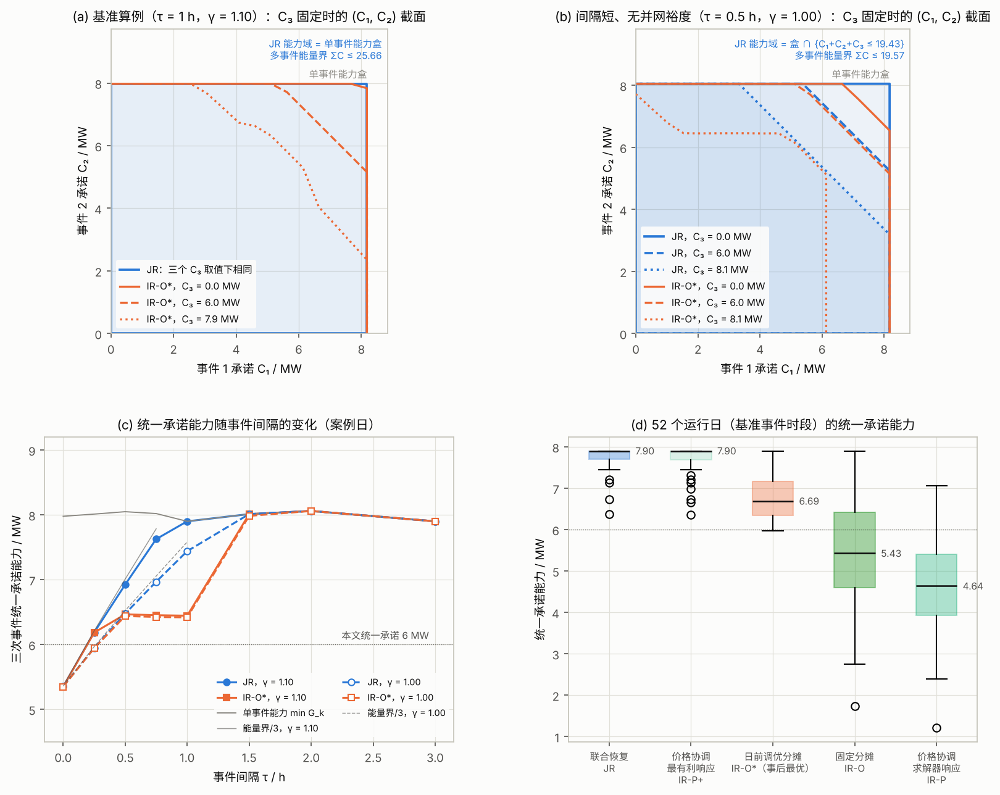

*图28 跨事件可交付能力域（实验 25，完美信息）。(a)(b) 固定事件 3 的承诺 $C_3$ 时，$(C_1,C_2)$ 平面上的可交付区域：蓝色为联合恢复（由证书多面体给出，精确），橙色为每个承诺向量取事后最优分摊的 IR-O\*，灰框为单事件能力盒；线型表示 $C_3$ 的取值。(c) 三次事件统一承诺能力随事件间隔的变化（γ=1.10 实线，1.00 虚线），灰线为单事件能力的最小值与多事件能量界的 1/3（只画切面起作用的间隔）。(d) 52 个运行日（基准事件时段）的统一承诺能力；IR-P+ 为最有利的价格响应，IR-P 为求解器给出的响应。*

## 7 结论

1. **机理。** 前序响应留下“算力积压 + 储能缺口”双状态欠账，二者在事件间隔内争用同一个恢复通道。
   - 独立恢复要还清全部欠账：间隔 ≤1 h 时，后续事件只剩单事件能力的 38%–39%。
   - 联合恢复只偿还下一事件需要的部分，把长时限任务跨事件携带：同一事后状态下 0.75 h 即恢复到 96%。
2. **理论。**
   - 引理 1：时限约束既充分又必要。
   - 命题 1：可交付能力上界，80 个工况全部成立，可推广到多状态。
   - 定理 1：最小恢复间隔差的闭式解，与 LP 偏差 ≤1×10⁻⁵ MW。
   - 命题 2：单一通道价格，KKT 残差 2×10⁻¹²。
   - 命题 3：分布鲁棒日前承诺的精确 MILP 重构。
   - 命题 4：可交付能力域是凸多面体；多事件能量界在 24 个扫描工况与 52 个运行日全部成立，切面起作用时与精确值相差 ≤3.0%。
3. **价值主要在可靠可交付容量。**
   - 在 ≥95% 运行日三次全有效的要求下，联合恢复把可承诺容量由 6 MW/次提高到 8 MW/次（+33%）；价格协调的独立恢复在任何承诺水平都达不到这一可靠性。
   - 就可靠容量而言，联合恢复约相当于 9–12 MWh 电储能或 2.9 MW 并网容量。可靠容量处它把 6–7 MWh 当量的长时限积压携带进最后一个事件。
   - 电池并非越大越好：常态峰谷套利压低需求响应基线，电池每增加 6 MWh，事件时段基线下降约 0.6 MW。
4. **可交付能力域（6.18 节）。**
   - 联合恢复的能力域是“单事件能力盒 ∩ 一个总量切面”，可用 4 个数（三次事件的单事件能力与跨事件能量预算）描述，并有顶点证书。基准工况中三次事件互不影响：任意不超过单事件能力的承诺组合都能交付。
   - 独立恢复不降低单事件能力，但即使每个承诺向量都取事后最优分摊，跨事件能量预算也收缩 18%（统一承诺能力 7.90 → 6.44 MW）；52 个运行日中 IR-O\* 的统一承诺能力平均为联合恢复的 89%。
   - 只交换通道价格时，求解器任选的 IT 响应平均只能交付联合恢复能力的 60%；允许 IT 侧 0.1% 的次优，几乎都能交付。价格几乎包含全部所需信息，但不能确定一个可交付的计划。
   - 报价时申报这 4 个数即可让电网任意组合调用；间隔短、无并网裕度时，只调两次的承诺可比统一申报高 24%。
5. **成本。**
   - 统一 6 MW、52 个运行日中，JR-D 每天三次事件全部有效，最强基准为 86%–98%。
   - 相对每组最强基准，成本降低 2.9%（反弹定价口径，对 IR-P）、3.1%（只按江苏细则，对 IR-O\*）、4.0%（E3 不确定）。逐日配对检验 p<10⁻⁹，50–52 天更便宜。
   - 节省来源取决于结算口径：反弹定价口径下 78% 来自反弹考核，规则口径下 86% 来自多拿的补贴；能量成本几乎不变。
   - 承诺接近单事件能力时，降幅达 14%–16%。
   - “耦合承诺 + 联合恢复”相对现行“单事件评估 + 独立恢复”降低 12.6%。
6. **机理贡献。** 各侧优化（−4.25 万元/日）与跨事件远见（−2.28）贡献最大，其次是日前调优分摊（−1.70）与通道价格协调（−1.10）。没有跨事件远见的联合分配反而比价格协调更差（+1.61）。场景对冲的增量很小（−0.08）。
7. **政策含义。**
   - 反弹可定价、可调控：随考核价格升高，联合恢复平滑地压低反弹，且在任何价格下成本最低（低 2.6%–5.5%）。
   - 不设考核时，物理并网约束在间隔内仍形成 1260–1455 元/MWh 的通道价格。
   - 绿电占比约束相当于统一加价，不改变策略优劣。
   - PUE ≤1.25 可以以约 0.24 万元/日的代价达到，1.20 在高温日不可行。
   - 联络线爬坡上限会与快速削减冲突，需要与有效性判定一并设计。
8. **不确定性与稳健性。**
   - 末次事件以 0.6 概率被调用时，场景 MPC 只比确定性 MPC 低 0.4%（不显著）。
   - 分布鲁棒承诺（δ≈1.2）在样本外同时降低均值（−0.26%）与最差 10% 日（−0.4%），远优于单事件评估（−2.9% / −6.5%）。
   - 结论在五种分时电价形态（−2.1% 至 −2.9%）、苏州冬季与贵安夏季（−2.6% 至 −2.8%，每天全部有效）、液冷（−7.4%）、GPU 功率封顶（−2.9%）与机房热惯性（闭环 −2.2%）下成立。
   - IT 爬坡限制压缩联合恢复的空间（1 MW/15 min 时只剩 −0.8%）。
9. **作业级验证与大模型负荷（6.13 节）。**
   - 流体任务模型允许积压以任意并行度补算，对整组运行的刚性长作业过于乐观：按它做的计划在作业级执行时大量失效（PAI 负荷下任何策略三次全有效的天数 ≤8%），成本被低估 11%–38%（Acme 负荷为 6%–39%）。
   - 加入一阶刚性补算约束后计划可以执行：JR-D 三次全有效的天数在 Acme 大模型开发负荷下为 98%，在 PAI 负荷下为 86.5%（最强独立基准 46%–87%）；作业级成本仍比最强独立基准低 3.0%–5.0%（p≤10⁻⁹）。
   - 暂停/重启开销使日成本增加 2%–4%（慢检查点时约 3 倍）；整组粒度的影响 ≤1.4%；事件开始时 IT 功率的 1 min 阶跃为 3–4 MW。
10. **扩展（6.14–6.17 节）。**
   - 绿电直连风电：可再生占用电量比例在 10/20 MW 风电时达到 40%/58%，20 MW 时 94% 的日子同时满足 650 号文两项比例；按关口表计量的基线继承参考日风电，日前承诺随装机下降（20 MW 时 −63%），而联合恢复相对最强独立基准的成本优势扩大到 5.9%–6.6%。
   - 在流体模型中计入暂停/恢复开销，成本上升 3%–7%，独立基准的可靠性下降更快；功率封顶使联合恢复的优势扩大到 4.5%–4.8%，多档封顶相对单档只多降 0.2%。
   - 日前场景生成方式（分位、K-means、分布鲁棒）与季节漂移对样本外成本的影响 ≤0.35%；样本内估计普遍偏乐观 6%–14%，报价与投资评估应以滚动执行的结果为准。
   - 冬季余热回收供热比燃气锅炉每天省约 16% 的成本、16–19 t CO₂。没有蓄热时，热泵事后补热与补算争用通道，独立恢复三次全有效的天数降到 69%，联合恢复优势扩大到 4.4%；20 MWh 蓄热罐把供热与事件解耦，联合恢复多回收约 6 个百分点的余热；罐过大会压低基线。
11. **计算。** 日内 MPC 10 个场景时也不到 2 s；日前随机规划 ≤4.3 s，分布鲁棒 ≤25 s，均为一次求解的 MILP。
12. **局限。** 见第 8 节：流体任务模型（刚性补算约束为一阶近似）、轨迹（2020 年 PAI、单一机构 2023 年 Acme）、场景数有限、热惯性与政策参数取典型值、季节泛化只替换了气象、风电预测误差为合成误差、可交付能力域只在完美信息下计算。

---

## 8 局限与可扩展方向（论文中如实写明）

* **流体任务模型与刚性作业：** 基准模型把作业视为可任意分割的流体，作业级仿真（6.13 节）表明它对刚性长作业的补算过于乐观。本文加入的刚性补算约束 $y\le a/\Delta t+B/\tau_c$ 是一阶近似：假设暂停在作业间随机分配，没有表示“结束的延迟作业的尾巴”在名义负荷下降时提供的补算，因此流体记账会报告并不存在的逾期，刚性变体只能以作业级结果为准。更精确的做法是在规划中直接调度作业（混合整数），或用剩余运行时间分布构造补算核，留待后续工作。
* **作业级执行器：** 采用松弛度优先 + 按类目标回填的启发式，不是最优的作业级调度；作业由轨迹的“卡数—时长”分布合成，没有作业间依赖、网络拓扑与通信开销。检查点与重启开销取文献范围内的典型值，并做了“无/基准/慢/仅周期检查点”四种敏感性。
* **负载轨迹：** PAI 为 2020 年轨迹，Acme 为单一机构 2023 年的大模型开发轨迹（Hu 等，NSDI 2024[39]）。前沿规模的预训练作业可达数千卡，实验 20 只把作业卡数放大到 2–4 倍做了检验。秒级、迭代尺度的功率摆动（Choukse 等[14]）不在 15 min 调度的范围内。
* **反弹考核：** 江苏细则无此项，本文作为政策参数处理并给出扫描结果；需量电费分析表明现行两部制电价几乎不约束晚间反弹。
* **事件不确定性：** 只建模了“末次事件是否被调用”；事件时刻与持续时间的不确定性、以及“就绪储备”类产品设计留待后续工作。
* **场景数较少且确定性选取：** 日内 5 个、日前分布鲁棒 10 个历史联合场景，便于 MATLAB/Octave 结果一致。实验 23 用 K-means 从 280 种组合中选 5–20 个场景、并检验了季节漂移，样本外成本几乎不变（≤0.35%）。模糊集只在这些场景的概率上取（ℓ1 球），没有覆盖场景之外的分布；可改为 Wasserstein 球。
* **热惯性与政策约束的参数：** 机房有效热容、允许温升、绿电环境溢价取典型值，PUE 与绿电占比按日累计口径（政策为年口径），只用于敏感性分析。
* **季节与气候泛化：** 只替换气象，沿用同一组算力轨迹、江苏电价与需求响应规则；其他省份规则不同。
* **绿电直连与基线：** 风电按“表后、不上网”处理，需求响应仍按并网点电表计量。江苏基线取参考日的电表数据，会继承参考日的风电，使可交付承诺随风况波动（6.14 节）。若直连项目单独计量、按“毛负荷”结算，结论会不同，需要政策层面明确。风电日前预测为“实际出力 + AR(1) 误差”的合成预测（均方根 15% 装机），不是真实的数值天气预报；确认承诺为 0 的事件视为未申报、不考核，日前模型没有把是否参与作为决策变量；IR-O\* 的分摊比例只在案例日调优。
* **余热回收供热：** 热需求按度时法给定，没有表示供热管网的水力与温度动态；热泵 COP 取常数，未随回水与供水温度变化；供热价格与合同条款简化为“必须满足需求、不足由燃气锅炉补足”；燃气内燃机的余热仍只送吸收式制冷。
* **可交付能力域：** 在完美信息、固定事件时段与调用模式下计算。预测误差下的鲁棒能力域、电网侧如何按虚拟电池参数出清，以及通过迭代（如 ADMM）使价格协调的响应唯一，留待后续工作。
* **单母线聚合：** 未计配电网潮流与园区内部网络约束。
* **学术假设参数：** 所有 [A] 类参数均已在敏感性实验中检验方向性结论的稳健性。

---

## 参考文献（均已核对存在性；卷期页以出版社页面为准）

[1] IEA. Energy and AI[R]. Paris: International Energy Agency, 2025.
[2] Shehabi A, Smith S J, Hubbard A, et al. 2024 United States Data Center Energy Usage Report[R]. Berkeley: Lawrence Berkeley National Laboratory, 2024.
[3] 国家发展改革委, 工业和信息化部, 国家能源局, 国家数据局. 数据中心绿色低碳发展专项行动计划[Z]. 2024.
[4] Norris T H, Profeta T, Patiño-Echeverri D, Cowie-Haskell A. Rethinking Load Growth: Assessing the Potential for Integration of Large Flexible Loads in US Power Systems[R]. Durham: Nicholas Institute, Duke University, 2025.
[5] Chen Y, Zheng X. To Defer or To Shift? The Role of AI Data Center Flexibility on Grid Interconnection[J]. arXiv:2604.05376, 2026.
[6] Williams C, Colangelo P, Coskun A K, et al. Power-Flexible AI Data Centers: A New Paradigm for Grid-Responsive Compute[J]. arXiv:2606.25098, 2026.
[7] Texas Legislature. Senate Bill 6 (89th Legislature): large-load interconnection and curtailment[Z]. 2025.
[8] 国家发展改革委等. 电力需求侧管理办法（2023 年版）[Z]. 2023.
[9] 江苏省发展和改革委员会. 江苏省电力需求响应实施细则[Z]. 2024（2024 年 7 月 14 日起施行）.
[10] Colangelo P, Coskun A K, Megrue J, et al. Turning AI Data Centers into Grid-Interactive Assets: Results from a Field Demonstration in Phoenix, Arizona[J]. arXiv:2507.00909, 2025.
[11] Acun F, Hankendi C, Levine E, Reynolds H, Bardwick J, Coskun A K. Investigating Power Consumption Flexibility of AI Data Centers for Demand Response Participation[C]. ACM e-Energy, 2026.
[12] Du B, Fan X, Du E, Chen L, Han J, Hou Q, Zhang N, Kang C. From Tokens to Energy Flexibility: Quantization-Enabled Demand Response for Data Centers with LLM Inference Workloads[J]. arXiv:2606.18851, 2026.
[13] Li M. Beyond Scalar Flexibility: From Eligible AI Workloads to Dependable Load Relief[J]. arXiv:2609.05406, 2026.
[14] Choukse E, et al. Power Stabilization for AI Training Datacenters[J]. arXiv:2508.14318, 2025.
[15] Evans M P, Tindemans S H, Angeli D. Flexibility framework with recovery guarantees for aggregated energy storage devices[J]. IEEE Transactions on Smart Grid, 2022, 13(5): 3519-3531.
[16] Liu Z, Wierman A, Chen Y, Razon B, Chen N. Data center demand response: Avoiding the coincident peak via workload shifting and local generation[J]. Performance Evaluation, 2013, 70(10): 770-791.
[17] Wierman A, Liu Z, Liu I, Mohsenian-Rad H. Opportunities and challenges for data center demand response[C]. IGCC, 2014.
[18] Chen M, Gao C, Song M, et al. Internet data centers participating in demand response: A comprehensive review[J]. Renewable and Sustainable Energy Reviews, 2020, 117: 109466.
[19] Radovanović A, Koningstein R, Schneider I, et al. Carbon-aware computing for datacenters[J]. IEEE Transactions on Power Systems, 2023.
[20] Han O, Ding T, Yang M, et al. A novel 4-level joint optimal dispatch for demand response of data centers with district autonomy realization[J]. Applied Energy, 2024, 358: 122590.
[21] 林嘉瑜, 韩俊涛, 王永真, 等. 计及㶲效率的低碳数据中心算力综合能源系统规划及运行优化[J]. 上海交通大学学报, 2025, 59(9): 1327-1337.
[22] 范宏, 陈舒阳, 罗昊, 等. 考虑冷热电多能互补与负载时空可调特性的数据中心优化运行策略[J]. 南方电网技术, 2026, 20(5): 28-36.
[23] Hao H, Sanandaji B M, Poolla K, Vincent T L. Aggregate flexibility of thermostatically controlled loads[J]. IEEE Transactions on Power Systems, 2015, 30(1): 189-198.
[24] Patel P, Choukse E, Zhang C, et al. Characterizing Power Management Opportunities for LLMs in the Cloud[C]. ACM ASPLOS, 2024: 207-222.
[25] Google. Demand response agreements with Indiana Michigan Power and the Tennessee Valley Authority targeting machine-learning workloads[EB/OL]. 2025-08-04.
[26] Fan X, Weber W-D, Barroso L A. Power provisioning for a warehouse-sized computer[C]. ISCA, 2007.
[27] 国家发展改革委, 国家能源局. 关于有序推动绿电直连发展有关事项的通知（发改能源〔2025〕650号）[Z]. 2025-05-21.
[28] Gaertner E, Rinker J, Sethuraman L, et al. Definition of the IEA 15-Megawatt Offshore Reference Wind Turbine[R]. NREL/TP-5000-75698, 2020.
[29] Meta. Odense data center: heat recovery to the Fjernvarme Fyn district-heating network[EB/OL]. 2018（设计回收约 100 000 MWh/年，后扩建；Ramboll 设计的热泵站把水加热到 70–75 °C）.
[30] Huang P, Copertaro B, Zhang X, et al. A review of data centers as prosumers in district energy systems: Renewable energy integration and waste heat reuse for district heating[J]. Applied Energy, 2020, 258: 114109.
[31] Wahlroos M, Pärssinen M, Rinne S, et al. Future views on waste heat utilization – Case of data centers in Northern Europe[J]. Renewable and Sustainable Energy Reviews, 2018, 82(2): 1749-1764.
[32] Chao H. Demand response in wholesale electricity markets: the choice of customer baseline[J]. Journal of Regulatory Economics, 2011, 39(1): 68-88.
[33] Wrinch M, Dennis G, El-Fouly T H M, Wong S. Demand response implementation for improved system efficiency in remote communities[C]. IEEE EPEC, 2012.
[34] 国家发展改革委办公厅. 关于完善两部制电价用户基本电价执行方式的通知（发改办价格〔2016〕1583号）[Z]. 2016.
[35] 生态环境部, 国家统计局. 关于发布 2022 年电力二氧化碳排放因子的公告[Z]. 2024.
[36] Schildbach G, Fagiano L, Frei C, Morari M. The scenario approach for stochastic model predictive control with bounds on closed-loop constraint violations[J]. Automatica, 2014, 50(12): 3009-3018.
[37] Weng Q, Xiao W, Yu Y, et al. MLaaS in the Wild: Workload Analysis and Scheduling in Large-Scale Heterogeneous GPU Clusters[C]. USENIX NSDI, 2022.
[38] Stojkovic J, Zhang C, Goiri Í, Torrellas J, Choukse E. DynamoLLM: Designing LLM Inference Clusters for Performance and Energy Efficiency[C]. IEEE HPCA, 2025.
[39] Hu Q, Ye Z, Wang Z, et al. Characterization of Large Language Model Development in the Datacenter[C]. USENIX NSDI, 2024.
[40] Latif I, Newkirk A C, Carbone M R, et al. Empirical Measurements of AI Training Power Demand on a GPU-Accelerated Node[J]. arXiv:2412.08602, 2024.
[41] Xu B, Zhao J, Zheng T, Litvinov E, Kirschen D S. Factoring the cycle aging cost of batteries participating in electricity markets[J]. IEEE Transactions on Power Systems, 2018, 33(2): 2248-2259.
[42] Dobos A P. PVWatts Version 5 Manual[R]. NREL/TP-6A20-62641, 2014.
[43] Wan B, Han M, Sheng Y, et al. ByteCheckpoint: A Unified Checkpointing System for Large Foundation Model Development[C]. USENIX NSDI, 2025.
[44] Wang Z, Jia Z, Zheng S, et al. Gemini: Fast Failure Recovery in Distributed Training with In-Memory Checkpoints[C]. ACM SOSP, 2023.

> 说明：参考文献按首次引用顺序编号。[19] 的卷期页码、[7][25] 的正式条目、[11] 的页码、[35] 的文号请投稿前在出版社/官网再核对。论文中可补充国内期刊近三年关于数据中心需求响应、综合能源系统滚动优化的文献。

## 附录 A 复现方法

```matlab
cd matlab
main_run_all                                % 全部 25 个实验（Octave+glpk 单进程约 16.5 h）
QUICK = true; main_run_all                  % 冒烟测试（小样本、小网格）
RUN = [2 5]; main_run_all                   % 只跑部分实验
```

Octave 并行（本文正式结果的运行方式：4 进程约 2 h，第二批约 40 min；实验 14 计时须在空闲机器上单独运行）：

```bash
tools/run_parallel.sh A "RUN=[4 13]; MC_PART='uncertain';"
tools/run_parallel.sh B "RUN=[4 8 9 11]; MC_PART='certain';"
tools/run_parallel.sh C "RUN=[2 6 7 15];"
tools/run_parallel.sh D "RUN=[3 10 12];"
# 以上完成后
tools/run_parallel.sh E "RUN=[16 17 18];"
tools/run_parallel.sh F "RUN=[19 20];"
tools/run_parallel.sh G "RUN=[21 22 23 24];"
tools/run_parallel.sh H "RUN=[25];"                                # 约 40 min
tools/run_parallel.sh T "RUN=[14];"
```

实验 1、5 不受独立基准修正的影响，仓库中的结果来自同一代码的早先运行；需要时可用 `RUN=[1 5]` 重跑。

- 全部数值与统计检验：`python3 tools/summarize_results.py`。
- 图（中文 / 英文）：`python3 tools/plot_results.py [--en]`。
- 架构图与框架图：`python3 tools/draw_diagrams.py [--en]`。
- 冬季与贵安气象：`python3 data_prep/fetch_weather.py LAT LON START END OUT.csv`（Open-Meteo ERA5）。
- Acme 轨迹与作业分布：`python3 -I data_prep/prepare_acme.py --seren … --kalos … --pai …`；海上风速：`python3 data_prep/fetch_wind.py 32.60 121.60 2024-06-01 2024-08-31 data/wind_rudong_2024summer.csv`。
- 实验 19 的四个变体、实验 21 的装机与实验 22 的设定都可拆到多个进程运行（`variants` / `P` / `settings` 与 `tag` 选项），汇总与作图程序会自动合并各部分的 CSV。
- 单项冒烟测试：`matlab/tests/`。其中 `test_policy.m`、`test_ramp.m` 断言新功能默认关闭时基准结果不变，`test_exp15.m` 检验命题 3 的两个极限，`test_region.m` 检验能力域（各独立基准的可交付域在联合恢复域内、多事件能量界成立、基准工况的证书多面体精确），`test_jobsim.m` 检验作业级仿真器（不响应日重放精确）、刚性补算约束、暂停开销、多档封顶、K-means 场景与风电输入。

---

## 附录 B 对审稿意见的逐条修改对照

### B.1 第一部分：必须解决的关键问题

| 审稿意见 | 修改 | 证据（本文位置） |
|---|---|---|
| 1. 结论依赖自设“反弹考核” | 反弹考核改为政策参数：规则口径（$c^{\rm rb}=0$）与反弹定价口径（3 元/kW）两套结果并列，并在 0–6 元/kW 扫描；补充需量电费分析；结论改写为“联合恢复使反弹可定价、可调控” | 3.3 节；6.6、6.8 节；实验 8；图 10 |
| 1b. $c^{\rm rb}=0$ 时的影子价格 | 给出 γ=1.10/1.00 × $c^{\rm rb}$=0/3 四种组合的通道价格；$c^{\rm rb}=0$ 时物理并网约束在事件间隔内取正影子价格 | 6.6 节；`exp5_shadow*.csv` |
| 1c. 承诺—运行配对 | 单事件承诺、回测缩放的单事件承诺、耦合承诺 × IR-O\*/JR-D，在案例日与 20 个运行日上比较，两套口径；新增分布鲁棒承诺的样本外比较（实验 15） | 6.5 节；实验 6、15；图 9、15 |
| 2. 基准偏弱 | 新增 IR-O\*（日前回测调优 α，网格 0.2–1.0）、IR-P（日前影子价格协调）、JR-M（逐事件联合）；敏感性实验用事后最优 α 与完美信息价格；独立基准的 IT 功率预算计入燃气内燃机可调出力（修正早期版本在重负荷夜间逾期的问题）；摘要数字改用最强基准 | 4.3 节；全部结果表 |
| 3a. 事件前抬升与真实削减 | 新增“相对同日不响应运行的真实削减”与事件前抬升指标；抬升来自为事件保留储能，而不是操纵基线；1000 元/MWh 的抬升考核不改变调度 | 3.4 节；6.2、6.10 节 |
| 3b. 与窗口无关的反弹指标 + 碳排放 | 新增事件后 6 h 最大反弹、间隔回补电量、最大爬坡、晚高峰、碳排放 | 3.4 节；各结果表 |
| 3c. 期末状态不一致 | 期末积压按平段能耗计价（规划与评价一致），储能缺口按回充成本折算；任务延迟成本计入综合成本 | 3.4 节 |
| 4a. 事件调用不确定性 | E3 以 0.6 概率被调用、提前 1 h 确认；JR-S 用场景树，确定性方法用确定性等价；给出与完美信息、确定性 MPC 的差距 | 6.3 节；实验 4c |
| 4b. 样本与统计 | 52 个运行日（交叉配对），均值 95% 置信区间、逐日配对差与 Wilcoxon 检验 | 5.1、6.3 节 |
| 4c. 价格敏感性 | 补贴单价 1/2/3 元/kWh × 偏差系数 0.5/1/2 | 6.8 节；实验 9 |
| 5. 理论 | 引理 1（时限约束的精确性）；命题 1 完整证明及多状态推广；定理 1 闭式解（最小恢复间隔差、能力差、无价值条件），68 个工况与 LP 偏差 ≤1×10⁻⁵ MW；命题 2 单一通道价格，KKT 残差 2×10⁻¹²；命题 3 分布鲁棒承诺的精确 MILP 重构 | `理论推导.md`；6.1、6.5、6.6 节 |
| 6. 真实性与文献 | 液冷、IT 功率爬坡（软约束）、GPU 功率封顶、事件前抬升考核四类敏感性；机房热惯性、PUE 与绿电约束、联络线爬坡；分时电价形态、季节与气候泛化；碳排放；补充 2025–2026 文献并说明与 Evans 等（恢复保证）的区别 | 6.10、6.11 节；1.1–1.2 节 |
| 6f. 大模型轨迹与作业级验证 | 新增 Acme 大模型开发轨迹（Hu 等[39]，长作业占 80% 的 GPU·h）；建立作业级仿真器（整组刚性作业、检查点/重启开销、最短暂停），每次闭环运行都在作业级重放并重新结算。发现流体模型对刚性长作业过于乐观，加入刚性补算约束 $y\le a/\Delta t+B/\tau_c$ 后计划可执行（JR-D 三次全有效：Acme 98%、PAI 86.5%），联合恢复在作业级仍比最强独立基准低 3.0%–5.0%；另做作业组合、暂停开销与整组粒度的敏感性 | 3.1、5.4、6.13 节；理论推导第 1 节末；实验 19、20；图 22、23 |
| （审稿意见之外的扩展） | 绿电直连海上风电与 650 号文曲线；暂停/恢复开销与多档功率封顶；K-means 场景与季节漂移；冬季余热回收供热（蓄热罐为第四类恢复状态） | 6.14–6.17 节；实验 21–24；图 25–27 |

### B.2 第二部分：提升创新性的方向（审稿意见建议选 1–2 个做深）

| 方向 | 修改 | 证据（本文位置） |
|---|---|---|
| 1. 跨事件可交付能力域 | **本次做深。** 把单个承诺值升级为可交付承诺向量的集合（凸多面体）；给出多事件能量界（命题 1 的 $K$ 事件形式，不需要假设 H1），即带回充的虚拟电池描述；用支撑函数与逐顶点 LP 给出可验证的内近似与精确性证书；独立恢复的损失表现为该集合的收缩；价格协调的可交付域取决于 IT 侧在等价最优响应中的选择 | 理论推导第 5 节（命题 4）；6.18 节；实验 25；图 28 |
| 2. “恢复欠账”统一框架 | 部分完成：命题 1 推广到机房热惯性（第三类状态）与余热蓄热罐（第四类状态），并给出各状态争用通道时的次序（补算与移除机房蓄热的通道效率为 1，电池回充为 η；余热蓄热罐只影响成本，不影响可交付能力）；功率封顶每降 1 单位功率留下 0.4 单位欠账（暂停为 1）；刚性作业的补算速率上限 $B/\tau_c$；内燃机无欠账、计燃料与碳成本。未做统一的“恢复优先指数” | 理论推导第 1、3 节；3.1 节；实验 17、19、22、24 |
| 3. 影子价格引导的分布式协同 | 部分完成：IR-P（只交换日前通道价格）作为最强基准之一；命题 4 第 5 条与实验 25 表明，最有利的价格响应可以达到联合恢复的能力域，但价格本身不能确定可交付的计划。ADMM 迭代留作后续工作 | 命题 2、命题 4；6.6、6.18 节 |
| 4. “感知恢复”的需求响应机制设计 | 部分完成：反弹考核作为政策参数扫描（0–6 元/kW）；能力域给出“按承诺向量（虚拟电池参数）申报”的规则改进。电网侧双层模型未做 | 6.8、6.18 节 |
| 5. 事件不确定下的“就绪储备” | 部分完成：分布鲁棒 / CVaR 日前承诺（命题 3）与事件调用不确定性（场景 MPC）。独立的就绪储备产品留作后续工作 | 命题 3；6.3、6.5 节；第 8 节 |

### B.3 第三部分：次要意见

| 意见 | 修改 | 位置 |
|---|---|---|
| 符号表 | 已补 | 第 2 节前的符号表 |
| 算法流程伪代码 | 算法 1（日前耦合承诺—日内联合恢复滚动调度） | 4.5 节 |
| 计算时间表 | 模型规模与求解时间随时域、场景数、事件数的变化 | 6.12 节；实验 14 |
| 摘要数字只保留最强基准下的结果 | 摘要与结论的成本比较均相对最强独立基准（IR-O\* 与 IR-P 中较好者） | 摘要；第 7 节 |
| 统一 GPU·h 与 MWh 的换算口径 | 统一用 $\varepsilon_t=(1+a+\theta/{\rm COP}_t)p^{\rm dyn}$（每 GPU·h 对应的设施用电）换算；期末积压按 0.67 元/GPU·h 计价 | 符号表；3.1、3.4 节；5.2 节 |
| 说明“双状态”实为 5 维状态向量 | 已说明：$(B_1,B_2,B_3,E,S)$，计入热惯性、蓄热罐时再各加 1 维 | 第 2 节 |

### B.4 第四部分：修改优先级

| 优先级 | 内容 | 完成情况 |
|---|---|---|
| 1 | 反弹考核敏感性/帕累托分析，基准 α 调优，修三处评价口径 | 已完成（B.1 意见 1–3） |
| 2 | 事件不确定性 + 扩大样本统计 | 已完成（B.1 意见 4） |
| 3 | 能力域或分布式协同，任选一个做深 | 已完成能力域（B.2 方向 1）；分布式协同部分完成（B.2 方向 3） |
| 4 | 闭式解与定理化 | 已完成（B.1 意见 5；命题 1–4、定理 1） |
